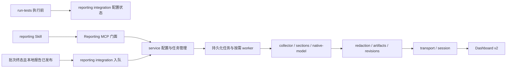

# MAVT 数据上报 v2 技术方案

合并验证补记（2026-10-26）：下述首轮 CLI stdin 失败已捕获为测试管道竞态，`readFileSync(0)` 在 dispatch 校验前遇到 `EAGAIN`；测试改为等待 stdin end 回调后释放 barrier，保留全部断言且不修改运行时代码，八轮并行的两项回归 16/16 通过，详见验证汇总。

更新：2026-10-26。五项审查问题已修复：死亡 reaper 保守保留并要求离线维护、spawn 异步 error 隔离、410 key 轮换证明与成功清理、失败/崩溃及未绑定快照有界回收、现代 Run 手动补报强制 PUBLISHED。独立复审未确认本次修复范围内的 P1/P2 问题，匿名探针 5/5、孤立回收回归 6/6 通过；最终静态源码的 `npm test` 退出 0，运行时 89 组、知识管理 6 组、插件 414/414 和 51 份生成文档检查通过。首轮既有 CLI dispatch 替换测试失败，定向及最终完整复跑通过，原因未确认，未修改该模块。

当前构建：`0.4.0`，四 Skill、38 工具（8 reporting）、24 reporting 模块；bundleId 为 `c085e1d9b710c39d803e74bfabc0d1b3f530284f96d463dabdeccb38d4a7f485`，350 manifest 文件、361 发布源文件逐字节一致、363 总分发文件，构建及独立重定位 stdio 探针通过。完整证据见 [验证汇总](../../../verification/summary.md) 的 2026-10-26 小节；未安装、合并或推送。

以下两段为 2026-10-23 的历史实施与验证记录，其旧构建和审查结论不代表当前结果；当前规则以本次更新和正文修订为准。

日期：2026-10-23。实施状态：Tasks 1–5 已实现并完成各自独立审查修复，Task 6 已构建 `0.4.0` 并完成固定 detached worker 成功上传/断线重放、重定位 stdio、实际 Codex 宿主与本地 Dashboard 校验器差分验证。最终分支审查提出的空/部分 owner 锁崩溃窗口及终态冻结包无后续清理路径已修复：私有锁完整 owner 原子发布，显式上报写入按已有所有权执行有界本地清理，COMMITTED 清理先核对完整冻结会话、持久状态、绑定及终态回执，worker 首次删除前持久化同一授权证明，七天后过期保留的终态/耗尽任务；只读状态及 Coordinator 自动入队不清理。运行时代码提交 `480deec` 的整分支审查与全部定向范围复审已通过，未留 Critical/Important/Minor 问题。该提交的 `npm test` 退出码 0，运行时 89 组、知识管理 6 组、插件 403/403（无失败或跳过）与 51 份生成文档检查通过；bundleId 为 `be354c745ac5145c4a5232a0b7f7af416804adafff6bb2dab0bf5f9ad1af2b61`。

2026-10-23 历史证据：四 Skill、38 工具（8 reporting）、23 reporting 模块；固定 bundleId `be354c745ac5145c4a5232a0b7f7af416804adafff6bb2dab0bf5f9ad1af2b61`，349 manifest 文件、360 发布源文件、362 总分发文件；实际固定 worker 在父进程退出后完成三端 63 文件描述符/40 次 PUT 的持久提交与清理，prepare/PUT/commit 已接收但响应丢失时可复用同包/同 key 显式恢复。完整命令、失败记录与验收边界见 [验证汇总](../../../verification/summary.md)。

controller 的两项实施裁决：`createReportingService` 仅注入轻量 repository/queue/launcher/clock，sourceReader/transport 留在 `createWorker`，原拟依赖重型 facade 注入的调用方需适配；为避免清理授权绕过丢失冻结数据，最终修复增加一次定向修复与范围复审，增加验证周期但不扩大产品范围。

本轮未提供临时隔离的已认证 Dashboard HTTP/DB/Web 服务或测试身份，真实 HTTP 持久化、数据库幂等对象数、五页签/原图/日志浏览器对应以及部署能力仍未验收；实际本地 schema/语义/图校验通过不等于这些边界通过。没有使用个人 Token、真机或生产服务，也没有安装、合并或推送。第 13 节及文中的评审建议保留方案审查阶段的历史结论，本段和验证汇总记录当前实施状态。

开发分支：`codex/mavt-reporting-v2`，基线提交 `8f800f4`；代码位于独立 worktree。MAVT 保持自包含，不依赖 Dashboard 仓库、其 uploader 或用户机器上的源码路径。

## 1. 已确认的需求与交付边界

- 直接接入 Dashboard v2，忽略旧 `tools/uploader` 与 v1 同步协议。
- 默认服务地址为 `https://mobile-backend.codemao.cn/mavtdashboard/`，允许修改；本地联调使用 `http://127.0.0.1:8080/`，也支持其他端口。
- 已确认启动的批次完成、取消或技术阻塞后，自动上报本批次的用例定义、已发布终态执行与完整证据；无执行的可信终态可只报定义，确认启动前取消不自动上报。
- 手动补报覆盖整个指定工作区的用例定义及每用例、每平台的最新终态执行；从未执行的平台不生成伪执行。
- Token 缺失或失效、服务不可用、上报组件异常均不阻塞测试，不改变测试结论，不回滚本地报告。
- 批次执行前展示上报配置状态；配置操作可独立进行，用户可以直接继续测试。
- 组件独立设计，测试流程只接入运行准备、终态入队两类边界；具体落在已有 prepare/confirm/advance/cancel 外层，设备和用例状态机不加入上传阶段。
- 新增 `mavt:reporting` Skill，覆盖配置、检查、补报、状态和重试；自动上报与 Skill 共用同一套实现。
- 本期不修改服务端、不安装插件、不修改个人 Codex 配置、不操作手机或模拟器；联调仅使用显式配置的本地服务与脱敏 fixture。

本方案将用户尚未逐项选择的细节具体化为评审建议：采用本地凭据文件填写 Token；任务使用按需启动、有时限的独立进程；多会话工作区同步允许明确展示部分提交结果。用户评审本方案后再编写实施计划和运行时代码。

## 2. 协议依据与现状

服务端参考提交为 `ac850a36d8d1ed603224adb7142905d3495b66db`，参考仓库为 `mavtdashboard`；同日复核同时包含该仓库尚未提交的 PASS/豁免校验修复及对应文档、测试。实施时重新核对差异，不能把本地文档当作线上能力证明。

协议依据：

- `docs/reporting-integration.md`：身份、三层数据、准备/上传/提交、修订、顺序、限制与错误。
- `docs/reporting/{manifest.schema.json,document.schema.json,sections.md}`：稳定层与可扩展报告容器。
- `docs/reporting/{content-inventory.md,native-report.md}`：本地报告完整性与原版五页签模型。
- `apps/api/src/reporting/{reporting.controller.ts,reporting-validation.ts}` 与 `packages/contracts/src/reporting-v2.ts`：实际接口与校验。

当前 MAVT 可复用的实现：

| 位置 | 复用方式与约束 |
| --- | --- |
| `scripts/lib/execution-reader.js` | 读取指定执行及原文快照、完成信息、指标和显示投影；必须检查 readability |
| `scripts/report/execution-trace.js` | 复用 trace/narrative 与已有操作脱敏；其默认值和吞读错行为不能作为完整采集证据 |
| `scripts/report/case-flow-projection.js` | 生成已有流程、验证台账和覆盖投影，不由上传器重新推断业务结论 |
| `scripts/report/report-service.js` | 复用已发布报告选择、指标与发布时间口径；不在 renderer 内直接联网 |
| `scripts/lib/execution-artifact-manifest.js` | 校验来源完整性与已登记文件；从报告引用生成上传闭包，不上传整个 manifest 对应目录 |
| `scripts/coordinator/agent-facing-service.js` | prepare 外层展示提示；confirm 外层固化目标；写调用外层在释放协调锁后检查终态；不把网络调用塞进状态机 |
| `scripts/mcp/{contract,bindings,management-service,worker-pool}.js` | 扩展 reporting 角色、工具与任务路由，保留固定版本和权限边界 |

现有本地执行选择器含运行中执行，并参考结束时间和读取优先级；v2 按 `startedAt` 比较执行。手动上报须在专用选择器中按协议筛选、排序，不能直接拿本地“当前执行”当作最新可上传终态。

## 3. 组件架构

接入方式比较：

| 方案 | 特点与取舍 |
| --- | --- |
| 独立组件＋按需任务进程（采用） | 测试流程只提交本地意图；支持失败恢复，进程归属和预算需明确实现 |
| 在批次收尾中同步上传 | 实现路径较短，但大附件和网络超时拖延最终响应，并占用 MCP 调用通道 |
| 常驻同步服务 | 可持续扫描和自动补偿，但引入安装、守护、升级和退出管理，超出首版所需范围 |



模块根目录建议为 `src/mobile-ai-visual-test/scripts/reporting/`，独立于 case-runtime 和平台适配器。

| 模块 | 单一职责 |
| --- | --- |
| `settings.js`、`credentials.js` | 用户级配置、目标规范化、凭据读取和安全配置摘要 |
| `identity.js`、`revisions.js` | 工作区稳定身份、匿名化盐、跨进程修订台账 |
| `selection.js`、`collector.js` | 批次/工作区范围选择、来源读取、完整性盘点 |
| `sections.js`、`native-model.js` | 标准分段与原版详情模型的确定性投影 |
| `redaction.js`、`artifacts.js` | 脱敏、安全路径、文件引用闭包、分片、哈希与冻结副本 |
| `contracts.js` | 本地输入及 v2 输出校验、协议错误，内置固定契约而非运行时加载外部仓库 |
| `transport.js`、`session.js` | 有界 HTTP/流、能力协商、缺失文件上传、幂等提交 |
| `jobs.js`、`worker.js` | 原子任务记录、锁/租约、按需进程、恢复和资源回收 |
| `repository.js`、`intents.js` | 私有元数据存储、版本检查、事务恢复；轻量意图与运行目标记录 |
| `service.js` | 提供组件门面，组合上述模块 |
| `integration.js` | 流程接入与异常隔离；不判断业务结果 |

实施时允许将过长的映射文件按分段拆开；不为这项能力重构现有 Coordinator、Case Runtime 或平台适配器。

### 3.1 依赖方向与扩展边界

- `integration` 仅依赖 settings 的安全摘要、intents 和进程启动门面；不能 require collector、报告 renderer 或 transport。调用处按需加载并捕获加载异常，缺文件/语法错误也不能使原测试入口加载失败。
- `service/jobs` 编排用例，`collector` 通过只读 SourceReader 适配器取得来源；`sections/native-model/redaction` 做确定性转换，`artifacts` 冻结文件，`session` 消费冻结包并驱动 transport。transport 不读取测试目录、不分配修订、不判断测试结果。
- repository 独占配置、身份、修订、任务和回执的持久化规则；业务模块不能各自拼状态文件路径或实现锁恢复。service 不堆积字段映射、HTTP 或文件系统细节。
- 轻量同步门面通过 `createReportingService({repository, settings?, credentials?, identity?, intents?, jobs?, launcher?, clock?})` 注入本地状态与启动边界；`sourceReader`、`transport` 等异步重依赖仅在 `createWorker(...)` 的同进程测试边界注入，不能把函数跨 detached 子进程传递。生产门面仍由默认 launcher 启动已验证的固定 bundle，不引入容器框架、动态代码插件或可执行远端策略。
- 标准分段采用静态注册表 `{kind, schemaVersion, shape, project, validate, collectRefs}`，约束为 17 类的统一注册入口；新增分段只增加注册项及 fixture。协议版本适配、来源格式适配、native renderer 适配分别注册，互不冒充版本。
- 首版 SourceReader 明确支持当前 `execution.schemaVersion=14`；旧 Run 可由新 reporting bundle 只读导出其兼容终态，不执行旧 Run 的命令。不支持的来源版本返回 `REPORTING_SOURCE_VERSION_UNSUPPORTED`，保留未来增加 reader 的位置，不承诺任意历史格式兼容。

接口数据用 JSDoc typedef 固定：RunReportingSnapshot、ReportingIntent、SourceInventory、ExportUnit、FrozenSession、JobView。`ExportUnit` 为一个定义及至多一个平台执行的依赖闭包；`FrozenSession` 包含不可变 Manifest 路径、hash、key、单元清单和限额快照。MCP 返回安全 View，不返回这些内部对象或完整文件内容。

### 3.2 本地状态与契约维护

reporting.json、identity、ledger、intent、job、session、receipt 均声明独立 `schemaVersion:1`，并记录 identityEpoch、exportVersion；读取拒绝未知主版本。只有显式写操作可执行已登记的前向迁移；固定旧 bundle 遇到较新不兼容状态时只拒绝自身任务，不覆盖或降级文件。兼容字段允许省略并使用已定义默认值。

`contracts.js` 实现固定 v2 的结构及语义断言，并保存协议快照版本/摘要与正反 fixture；不实现通用 JSON Schema 引擎，也不把现有 `validateAgentJson` 当成完整的 Schema 校验器（它不覆盖 maxLength、format、nullable 联合类型等协议约束）。开发验证可用明确传入的本地 Dashboard 路径对照真实校验器；生产包、默认测试不依赖该仓库。服务端契约变化时先更新适配器和同一组 fixture，再调整导出版本。

核心门面接口：

```typescript
readSettings(): SettingsView; // 仅安全摘要，不返回 Token
updateSettings(input: SettingsUpdate): SettingsView;
prepareCredentials(serverUrl: string): { credentialPath: string; configured: boolean };
checkConnection(): ConnectionCheck; // 同步门面等待有时限的独立 check 子进程；网络实现异步
preflight(workspace: string): ReportingHint; // 纯本地只读，不联网、不创建工作区身份
prepareRunSnapshot(input: ConfirmAttempt): RunReportingSnapshot; // 本地候选，尚不代表测试确认成功
acceptRunSnapshot(workspace: string, batchId: string, attemptId: string): RunReportingSnapshot; // 以持久确认事实激活或恢复
submit(input: SubmitRequest): Submission; // 固化轻量意图并启动/唤醒 worker，不等待上传
status(workspace: string, jobId?: string): JobView; // 只读，不能借查询启动任务
retry(workspace: string, jobId: string, options?: {acceptCredentialChange?: true}): Submission;
resetIdentity(workspace: string): WorkspaceIdentityView; // 仅 {workspaceId, identityEpoch}，不返回内部 anonymizationSalt
```

`SubmitRequest` 为 `{ workspace, scope: "batch" | "workspace", batchId?, trigger: "automatic" | "manual", runtimeRoot, bundleId }`；批次范围必须有 batchId，来源从可信 Run 读取，客户端不能指定任意 execution 路径。`Submission` 返回 `{ jobId, state, serverUrl, code? }`；不以 HTTP/MCP 送达等同于 COMMITTED。

除 check 的有界子进程等待外，上述门面均只做本地短操作；异步 I/O 和上传在独立 worker 内执行。MCP `createServer.callTool` 与 worker-child 当前同步返回，不能直接返回 Promise 让其被误包装为成功。

## 4. 配置保存、地址与用户交互

### 4.1 配置位置

使用 `$XDG_CONFIG_HOME/mavt/`；未设置时使用 `~/.config/mavt/`。现阶段与 MAVT 的 Unix/macOS 运行环境一致，不新增 Windows 支持承诺。用户级目录不放在插件缓存、源码仓库或某一个测试工作区里。

```text
~/.config/mavt/
  reporting.json           # 当前目标、默认自动上报开关、分目标提示状态
  credentials.json         # 规范化服务地址 -> Token，仅进程读取

<workspace>/workspace.json # 保留原格式，首次有效上报前补充持久 id
<workspace>/.mavt/reporting/
  identity.json            # 匿名化盐及本地身份元数据
  revisions.json           # 工作区/用例定义/执行的全局语义修订台账
  runs/<batchId>.json       # 本批次冻结目标、自动开关和提示/入队记录
  attempts/<attemptId>.json # 确认前候选，由 initialization.reportingAttemptId 绑定
  transactions/<id>.json   # 身份/修订分配恢复记录
  destinations/<id>/       # 分服务、凭据代际的任务索引和提交回执
  jobs/<jobId>/            # 意图、状态、不可变 Manifest、原始待发文件
```

配置及 reporting 私有目录权限 `0700`，凭据、冻结文件和任务元数据 `0600`；私有原子写入器在创建临时文件时即设置权限，不复用默认权限的 writeJsonAtomic。全局设置和凭据模板更新使用独立的配置目录锁，避免多个工作区覆盖彼此更新；原子写入拒绝符号链接及路径越界。Token 不进入 MCP 参数/响应、聊天、命令行、子进程环境、日志、Manifest 或报告附件；MCP 只读回是否配置及错误码。首版使用受权限保护的本地明文文件，不宣称操作系统密钥链加密。

地址默认值为正式地址。规范化规则：HTTP(S)、禁止 userinfo/query/hash、规范化端口和尾斜线、保留部署路径前缀；HTTPS 通用支持，HTTP 仅允许 loopback 方便本地测试。`localhost` 与 `127.0.0.1` 作为不同显式目标，不自行猜测等价。使用相对路径 `api/v2/reporting/...` 拼接，避免前导 `/` 丢掉 `/mavtdashboard/`。禁止跟随携带凭据的重定向。

Token 按完整规范化服务地址分别保存；正式环境与本地配置、会话和成功回执隔离。修改地址不删除原目标 Token；不将原 Token 自动发送到新地址。首版不做浏览器代登录或替用户生成/撤销服务端个人 Token。

### 4.2 首次配置与提示

`mavt:reporting` 中文名“数据上报”。用户说“配置 MAVT 上报”时：读取安全配置摘要 → 展示地址（可修改）→ 提供对应 Dashboard 生成个人 Token 的入口 → 创建/定位凭据文件并由宿主打开 → 用户保存 → 显式执行连接检查。Agent 不读取凭据文件正文；更新已有模板不能覆盖其他目标或既有 Token。

执行前提示与既有批次确认合并，不新增必须答复的问题：

> 上报目标：正式环境；未配置 Token。本批次将正常执行并生成本地报告；可先配置上报。

初次可附“配置上报”入口；后续只保留短状态。提示状态按目标持久化，仅用户配置/确认提示等写操作更新；只读设置查询不修改“已提示”状态。用户确认执行就继续，不强制进入 reporting Skill，也不做网络预检。

批次结束显示测试结果、本地报告路径及上报状态。缺少 Token 显示 `SKIPPED_UNCONFIGURED`；网络或认证失败显示可恢复原因；任务尚在执行时明确显示“正在上报”，不能显示成功。用户查看进度、报告或配置时不自动上传。

自动上报默认开启，配置了目标 Token 后生效；全局可关闭。首版工作区沿用当前全局目标，不新增隐式工作区目标优先级。运行前将目标 URL 和开关冻结在独立 reporting Run 记录中，避免长批次期间切换全局地址改变本批次目标。关闭自动上报不禁止手动补报。

目标冻结使用确认尝试的两阶段侧车，不修改测试确认含义：`executeRunRequest` 外层在 USE_CURRENT/CONFIRM_ENVIRONMENT/CONFIRM_BINDING 请求进入 core 前，为本次 attemptId 短写独立不可变 CANDIDATE，固定 URL、autoUpload、配置摘要、credential generation 和确认请求摘要，并通过 options 传入 attemptId。`startInitialization` 在原有初始化状态保存中附带可选 `initialization.reportingAttemptId`；外层仅将该持久化 ID 指向的候选置为 ACTIVE，运行侧车保存其指针。配置提醒若与候选不一致，确认响应展示本批次实际目标。SELECT_PLATFORM 等选择操作不冻结目标。

core 可能长时间准备环境，不能等其返回才读取全局目标；中途失败或进程退出时，以已持久化的 environmentConfirmed/initialization/reportingAttemptId 事实恢复对应候选。并发尝试各有文件，未接受的候选不覆盖已接受候选；已接受候选永不按当前全局设置重建。旧 Run 没有此标记时不补猜自动目标。外层收尾无论成功或异常均尝试短恢复，保留原响应/异常；不把 reporting 故障变成测试异常。候选丢失/损坏或写入失败时本批次上报标为不可用，仍继续测试，不在结束时猜目标。

Token 在确认后才新增或改变时，不自动替本批次绑定新凭据；提示用户完成后手动补报，或显式恢复被暂停的上报任务。此规则避免长批次切换账号时无意改变归属；执行前配置好 Token 再确认即可正常自动上报。

## 5. 工作区身份、修订与并发

### 5.1 稳定身份

在第一次真实提交任务时，校验工作区 READY 并在上报身份锁内为缺失的 `workspace.id` 分配 UUID，写回 `workspace.json`，保留已有未知属性；不根据名称、路径或目录内容推算 ID。新建工作区可以在正常初始化时生成同格式 ID。只读查询和未配置 Token 的测试不迁移工作区。

改名或移动目录保留 ID。拷贝工作区形成独立项目时，通过 `mavt_reporting_identity_reset` 显式生成新 ID，更新匿名化盐并重建该身份的修订台账；先要求没有活动上传任务，旧上传记录转为本地归档，不删除测试数据或服务端业务记录。无法仅凭路径可靠区分移动与复制，首版不自动猜测。

identityEpoch 是本地身份代际，每个任务都冻结该值；reset 同时使旧代际待办失效，旧任务不能通过 retry 再写入新身份。ID、盐、台账初始化/重置作为 repository 可恢复事务处理；部分写入先完成恢复，再允许下一次导出，不能只重建盐而沿用旧修订。

### 5.2 修订台账

`workspace.revision`、每用例 `definitionRevision`、每执行 `revision` 从 1 开始，按最终脱敏语义内容变化单调递增；所有进程共用工作区台账。台账在网络发送前原子持久化，失败的网络尝试不回退已分配版本。

- 用例标题、caseNo、当前原文、定义文档和附件描述的变化均属于定义修订。
- 执行文档、索引摘要和依赖附件内容/用途/扩展属性的变化均属于执行修订。
- 文件 ID 由稳定逻辑身份生成；序列化顺序、分片与排序确定，不掺入采集时间、随机 jobId、上传 URL 等易变字段。
- 语义摘要忽略 gzip/identity 传输方式和重试时间，包含文档未知属性及递归依赖内容。更改导出/脱敏策略改变内容时正常增加修订。
- 同执行的 caseKey/platform/startedAt 不可变；冲突时保留失败证据，不能改执行时间以绕过服务端顺序规则。
- 切换上报目标不重置修订号；目标级成功缓存只作优化，实际缺失文件仍由服务端协商。

修订台账丢失时，不默认为 1 覆盖旧记录。已有上报痕迹但缺台账返回 `REPORTING_REVISION_STATE_MISSING`；首版要求恢复本地台账或显式作为独立项目重置身份，不擅自猜测服务端 revision。

元数据锁只覆盖 ID、版本分配、入队/状态更新，绝不持锁进行网络调用或整目录扫描。任务 worker 每工作区最多一个，按可运行任务的入队顺序处理；凭据等待、拒绝、未到 nextRetryAt 的任务不阻塞其他目标的可运行任务，只有无可运行任务才因等待而退出。跨工作区可并行；单任务内文件上传并发默认为 2，不超过服务端 concurrentUploads。服务端返回 429 时遵守退避，因为多个工作区仍可能共享同一用户配额。

### 5.3 指纹、修订分配和崩溃恢复

语义指纹与最终文件 hash 分开：先对脱敏后的稳定描述符及其递归依赖计算 fingerprint，再分配 revision，最后生成含 revision 的 Manifest。fingerprint 仅排除所属索引的本次修订字段、传输 encoding 和本地任务元数据；不能递归删除未知业务属性中的同名 revision。依赖纳入稳定 fileId、sha256、bytes、mediaType、purpose、extensions；采用固定对象键排序及数组顺序。jobId、采集时刻只存在本地任务中。相同来源和导出策略重复生成的文档字节与 fileId 必须一致，避免每次重建都增加修订。

repo 分配步骤为：流式生成 staging 内容及指纹 → 短锁内持久化 PREPARED 修订预约（包含目标旧值/新值、事务 ID、包身份）→ 锁外生成最终 Manifest 并复核来源 → 短锁内更新 ledger、发布 PACKAGE_READY 及完成标记。任何新修订预约前先处理尚未完成的预约；崩溃恢复按事务 ID 幂等 roll-forward，不从部分 ledger 猜版本，不用另一份数据复用原预约。来源已变或 staging 不完整时该预约作废且已分配版本不回退，以新事务重新采集。

只有 ledger 和 PACKAGE_READY 均可由事务记录确认后才允许 prepare HTTP；重复网络尝试始终读取同一冻结包。包已发送或可能已提交后，不重新采集覆盖原包。显式补报生成新任务并按当前语义分配必要修订。

## 6. 采集范围与数据映射

### 6.1 选择规则

自动任务从终态 Run 的批次清单冻结 `{caseKey, platform, executionId}`，后续不随“最新”指针变化；上传被延迟后由服务端判断 STALE_IGNORED。批次中未开始/被跳过的用例只上报定义，不生成执行。

手动任务按实际 `startedAt` 选每用例、每平台最新终态执行：包括成功、失败、技术阻塞、取消和有可信关闭记录的缺失结果；排除真正 RUNNING、未完成发布事务和无可信终态的中间状态。相同 startedAt 的不同 executionId 作为显式冲突返回，不能按目录名猜顺序。较新损坏执行不能被悄悄跳过而选旧 PASS 冒充当前结果。

将本地已发布元数据与来源控制文件组成读取签名，采集前后复验；来源改变则重新采集并重新分配必要修订。完整执行终态按原有完成/产物校验读取；可变发布时间侧车亦参与导出内容签名。冻结的是上报副本，永不改写原始证据。

### 6.2 状态映射

| MAVT 来源状态 | v2 executionStatus | v2 displayStatus |
| --- | --- | --- |
| 正常完成且有有效 result | `COMPLETED` | 原始 PASS/FAIL/BLOCKED/INCONCLUSIVE/NOT_RUN |
| 已取消 | `CANCELLED` | `CANCELLED` |
| 有可信技术终态/关闭、未产生有效 result | `FAILED` | `RESULT_MISSING`，保留来源 BLOCKED/NOT_RUN 及失败原因扩展 |
| 完成标记存在但结果缺失 | `FAILED` | `RESULT_MISSING`，runtime 说明缺失原因 |
| 运行中或事务尚未发布 | 不生成执行描述 | 任务记录明确排除原因 |
| 身份/原文快照损坏、无法可靠读取 | 阻止该工作单元提交 | 显示采集错误，不伪造 execution 或 verdict |

`runtime` 与 Manifest 使用相同映射，完整保留 sourceExecutionStatus/display 等来源属性。缺结束时间使用 `endedAt:null` 及 `endedAtReason`；durationMs 采用报告总耗时，缺失为 null；合法 UTC 毫秒时间不改写为当前时间。当前用例原文改变不重写历史执行快照；在扩展与健康信息中标明 sourceCurrent。

索引 startedAt 固定取 `execution.startedAt` 并规范为 UTC 毫秒，选择、runtime 与修订身份均使用此值；`display.startedAt` 可能取更早的 caseProcessingStartedAt，仅保留作原版展示和总耗时依据，不能在两者之间切换导致同执行身份变化。无法解析或超过服务器允许偏差时明确失败，不能改成上传时间。SourceInventory 在会话拆分前检查全局 executionId 唯一及其 caseKey/platform 绑定；本地 ID 分配仅保证每个 runtimeDir 不重复，跨用例/平台冲突时返回 `REPORTING_EXECUTION_ID_COLLISION`，不通过拆会话或自动改名绕过服务端身份规则。

### 6.3 报告分段

| 数据 | 来源与导出方式 |
| --- | --- |
| 当前定义 | `case.json`、`source.md` → `case-source` 与 `mavt-native-case` |
| 执行时定义 | `case.snapshot.json`、`source.snapshot.md` → execution `case-source`，不拿当前原文代替 |
| 运行/结论 | execution/completion/result/display → `runtime`、`checks` |
| 流程/台账 | `projectCaseFlowViews(report)` 及 flow 事件 → `flow`；保留节点、边、来源依据和修订 |
| 动作/序列/场景 | operations、sequences、scenes 及 trace → `actions`、`sequences`、`scenes` |
| 空间证据 | 空间投影及其底图/标注 → `spatial-evidence`，保留坐标系与关联 |
| 叙述/决策/调用/事件/耗时 | trace、narrative、events、invocations、spans → `records`、`invocations`、`events`、`timing` |
| 指标与知识 | 已有指标投影、实际使用的知识快照 → `metrics`、`knowledge` |
| 日志、健康、完整性 | 报告实际使用日志、report-metadata、completion/artifact 校验摘要 → `logs`、`report-health`、`integrity` |

执行必须声明七类核心段落：case-source/runtime/checks/flow/actions/scenes/metrics；前两类必须 available。其余分段只在确实没有记录时使用 available 空集合；本该有但无法提供时使用 unavailable/reason；来源没有该能力时使用 not-applicable/reason。读取错误不能被 trace 中的空数组 fallback 掩盖，采集器先独立盘点并验证来源。

原版五页签使用 `mavt-native-report` 独立 JSON 附件，包含 `rendererVersion:"mavt-current/1"`、case、report、trace、views、artifacts；定义页使用 `mavt-case/1`。标准段落仍完整提供。列表摘要写入 `summary.extensions.mavt`，缺失指标省略或为 null，不补 0。未知段落/字段按协议保留。

### 6.4 文件引用闭包与脱敏

从标准文档、native 模型及其引用递归构建闭包；native 中的原版相对 ref 通过 artifacts 映射至 fileId。只有实际依赖的截图、布局、日志、知识和资源快照进入清单；遇到路径、日志中恰好包含同名字符串时不盲目当作文件引用。闭包校验拒绝越界、符号链接、循环引用、缺失附件及不可达声明。

保留相对证据身份；将本地用户目录、绝对工具路径、设备标识、账号输入、Token/Cookie/密码等在导出副本中删除或替换。复用已有操作脱敏，再对标准段落、native 模型、原始 JSON/JSONL、文本日志和布局做统一处理；不能只脱敏 trace 而原样上传其 raw 附件。设备标识用工作区持久盐匿名化，保留平台和必要系统信息。

来源完成哈希仅作来源信息；脱敏后重新计算每个文件的 bytes 和 sha256。不自动对任意图片做 OCR/内容识别；截图沿用来源可共享证据，首版配置说明上传范围。明确标记为含敏感信息且没有安全导出副本的附件阻止对应单元发布，不原样发送或静默省略。截图内容脱敏能力不作为本期新增图像处理子系统。

不默认上传 APK/IPA/HAP、App 展开资源、工具链、动态库、runtime bundle、锁、会话凭据、缓存、知识草稿、历史执行全集、生成 HTML/CSS/JS。

### 6.5 与服务端逐字段对齐

数据范围覆盖服务端清单全部 17 种标准 kind，并额外提供两种 native 展示 kind。以下是传输数据的必要转换，不能将 MAVT 原对象直接塞入标准段落。额外源属性在完成脱敏与引用转换后保留；未知属性不允许覆盖这些权威字段。

| kind | 服务端 1.x 必需形状 | MAVT 转换约束 |
| --- | --- | --- |
| `case-source` | `{source,identity:{caseKey,title}}` | source 为脱敏后完整 Markdown；当前定义 title 与 cases.title 相同；执行使用当时快照 |
| `runtime` | `{executionId,platform,startedAt,endedAt,executionStatus}` | 与 Manifest 一致；endedAt=null 时额外提供 endedAtReason；displayStatus/durationMs 如提供亦须一致 |
| `checks` | `[{checkId,status,expected,actual}]` | checkId 取稳定 CHECK ref；expected/actual 必须显式存在，无法提取时为 null；保留原始处置、原因和证据关联 |
| `flow` | `{nodes:[{id,type,title}],edges:[{id,from,to}]}` | 节点 ref→id、text→title；边以稳定逻辑身份生成 id，from/to 指向已声明节点；保留原 flow 修订和属性 |
| `actions` | `[{operationId,type,outcome}]` | 原动作类型与结果状态映射为字符串；完整原动作对象保留为扩展数据 |
| `sequences` | `[{sequenceId,status,steps:[]}]` | 保留源步骤顺序、关联操作、部分成功及中断信息 |
| `scenes` | `[{sceneId,screenshot:{fileId}|null}]` | 无截图显式 null；有截图必须声明附件，布局等引用同样纳入闭包 |
| `spatial-evidence` | `[{operationId,kind}]` | 保留坐标系、请求/实际坐标、原图与标注证据 |
| `metrics` | 对象 | 保留源指标与单位，不将未知/缺失计数补为 0 |
| `records` | `[{id,type}]` | 从源事件/资源的稳定身份派生记录 ID，保留叙述和技术事实 |
| `invocations` | `[{invocationId,phase}]` | begin/end 分别保留 phase，不能合并掉调用原始记录 |
| `events` | `[{eventId,type,time}]` | 保留源序号、时间及详情；仅无源 ID 的导出记录使用确定性派生 ID |
| `timing` | `[{name,durationMs}]` | durationMs 非负，无法可靠求值的记录标明不可用，不编造 0ms |
| `logs` | `[{id,label,content:{fileId}}]` | 内容保留为独立脱敏附件；清单中必须可达 |
| `knowledge` | 对象 | 仅报告实际引用的查询、命中、调查及快照 |
| `report-health` | `{status,issues:[]}` | 汇总根/用例/平台健康信息，生产端完成检查后才给出状态 |
| `integrity` | 对象 | 记录来源完成校验；传输 hash/bytes 对最终导出字节重新计算 |

同一 kind 的多个段落/分片中，checks/actions/sequences/scenes/records/logs 的稳定 ID 全局不重复；流程节点、边 ID 唯一且边不能悬空。`data` 与 `dataFiles` 二选一；unavailable/not-applicable 必须有 reason 且不得携带 data/dataFiles。

`fileId` 是保留键。所有文档、JSON/JSONL 附件及文件描述符 extensions 中出现该键都被服务端递归识别为真实引用；顶层/producer/workspace 的 extensions 不允许出现 fileId。源业务属性与保留键冲突时必须显式报 `REPORTING_RESERVED_FIELD_COLLISION` 并给出脱敏字段路径，不能误发为悬空引用或静默删除原属性。

列表摘要严格按 native-report 文档映射：actions/observations←metrics.counts；sequences/sequenceFailures/transientCaptures←sequenceMetrics；checksCovered/checksTotal/waived/passWithWaivers←views.coverage；recoveries←executionRecoveryCount。旧版 sequenceFailures 仅在来源确认兼容时用 partialCount+interruptedCount。用例来源说明放 cases[].extensions.mavt.sourceSummary；批次说明可放 workspace.extensions.mavt.batchId。完整数据仍在文档层，不把大原文放入索引。

### 6.6 接收端修复复核与协议验证

2026-10-23 首次复核发现 PASS 与 WAIVED/NOT_APPLICABLE 的聚合校验冲突；服务端现已修复，本地复核确认解除该阻塞。修复位于当前服务端工作区，尚未提交，不据此推断正式环境已部署。

| 校验输入 | 修复后结果 |
| --- | --- |
| PASS＋PASS/WAIVED/NOT_APPLICABLE 混合 | 接受 |
| PASS＋全部 WAIVED，或全部 NOT_APPLICABLE | 接受 |
| PASS＋FAIL/BLOCKED/INCONCLUSIVE/NOT_ASSESSED | 拒绝 INVALID_DOCUMENT |
| 上述检查点分别使用内联、JSON 附件、JSONL 附件 | 三种形态均按上述规则校验 |
| 17 类标准段落完整组合，分别使用内联、JSON 附件、数组 JSONL 附件 | 三种形态均通过 Schema、语义与引用图校验；对象段落保持单个 JSON |
| checks 缺 expected/actual；flow 不转换 ref/text | 仍按协议拒绝，客户端必须落实 6.5 的字段转换 |

服务端上报相关单元测试 67 项、原版报告前端单元测试 11 项通过，Manifest/文档契约专测亦通过。标准段落组合和响应容量的独立探针结果仅本地保存在 `test-results/reporting-alignment-recheck.json`；首次修复前证据另存 `test-results/reporting-alignment-probe.json`，不覆盖历史结果。探针均重新计算最终文件 hash/bytes，不访问 HTTP、数据库、设备或个人凭据；前端单元测试也不代替实际浏览器联调。

实现保留真实检查点状态、reason、适用性扩展及整体结论，不把 WAIVED/NOT_APPLICABLE 改写成 PASS。列表 passWithWaivers/waived 继续从既有 coverage 投影生成，不能只依靠检查点获接收就假定列表豁免摘要齐全。当前未发现额外阻塞接入的服务端协议冲突；真实 MAVT 导出、HTTP 持久化及完整页面效果仍待实现后联合验收。

## 7. 大小、分片与冻结副本

首先 GET capabilities，使用实际版本、平台、分段与 limits；服务缺少 v2 或返回登录 HTML 时明确失败，不回退 v1。capabilities 样例不能当作线上响应；原版扩展可按 unknownSections 保留能力发送，并单独进行页面联调。

- 标准大数组按记录边界拆为 JSON 数组片段或 JSONL；对象型 dataFiles 仅一个 JSON 文件。
- JSON/JSONL 文档、分片、单行、引用深度、索引大小、文件大小均按能力响应校验；不把 JSON 改称 text 绕过限制。
- 图片保留原图；文本可 gzip，按原始字节哈希和计数，实际 gzipRatio 超限则选择 identity。
- 多文件按内容去重；只上传 missingFiles 返回的代表 ID，同哈希别名全部声明在本次清单。
- 超过 cases/executions/files/manifestBytes/sessionBytes 的工作区任务按“定义＋一个执行及完整依赖闭包”为不可拆单元分会话；用例只有定义时也可独立成单元。跨会话重复定义保持同一 revision 和相同内容。
- 单元自身超限返回明确错误，不能丢截图或截断日志后宣称完整。
- native 模型单 JSON 对象受当前 16 MiB documentBytes 限制；允许依文档将独立大日志放标准日志段落，原版模型仍不可合法缩小则返回 `REPORTING_NATIVE_MODEL_TOO_LARGE`。不宣称首版能无损渲染任意大 native 对象；扩展 renderer 需另行双方设计。

worker 先在 job staging 生成最终脱敏文件与 Manifest，校验后原子发布为不可变待发快照。staging 在首个附件写入前持久化 identityEpoch、创建时间、owner PID 及 job/claim 归属；失败时立即尝试按短锁分批释放，释放失败或崩溃后由显式写操作在七天后回收无活跃 owner、无任务引用的临时快照，包括已移入 packages 但尚未绑定任务的包。归属不明、旧 epoch 和未来版本保留；状态查询与 Coordinator 自动入队不清理。manifest.json 原始 UTF-8 字节和每会话 UUID key 在任何 prepare 前持久化。重复尝试读取原文件原字节；不能重新序列化替代重放。

按单执行顺序采集，附件流式复制/哈希/压缩，限制同时打开文件；解析对象受 documentBytes 与受控记录队列约束，不把整个工作区的图片和日志一次读入内存。磁盘不足、源文件变化等错误只影响上报任务。

既有 `readExecutionReport/buildExecutionTrace` 使用同步全量读取，复用它们不能宣称任意大执行的解析是流式。SourceInventory 先盘点实际需解析的结构化文件，首版单文件不超过 16 MiB、单执行唯一结构化来源累计不超过 32 MiB；超过返回 `REPORTING_SOURCE_BUDGET_EXCEEDED`，在构建 trace/native 前停止。独立文本/图片仍流式处理；不能通过把必需 JSON 改成文本绕过预算。后续若需要更大执行，单独增加可流式的 SourceReader/native renderer 适配并联合验证，不改协议状态含义。

一个任务在任何 HTTP prepare 前完成全部所选单元的采集和本地验证；任一必需单元失败则任务 COLLECTION_FAILED，明确坏单元，不跳过它后宣称工作区完整成功。PARTIAL 仅用于已冻结任务的多个会话中部分已提交的情况。冻结包按执行逐个产生并保存在磁盘，不能把整个工作区对象留在内存。

## 8. 上传任务、进程与恢复

### 8.1 状态与生命周期

任务主链：`QUEUED → COLLECTING → PREPARING → UPLOADING → COMMITTING → COMMITTED`。

旁路状态：`SKIPPED_NOT_STARTED`、`SKIPPED_UNCONFIGURED`、`SKIPPED_DISABLED`、`WAITING_PUBLICATION`、`NEEDS_CREDENTIAL`、`RETRYABLE_FAILED`、`REJECTED`、`COLLECTION_FAILED`、`PARTIAL`、`EXPIRED_LOCAL`。状态记录包含 jobId、冻结目标、scope/batchId、identityEpoch、bundleId、exportVersion、阶段、会话列表、错误码和 byte 指标，不包含 Token。提交回执保存各项 CREATED/REPLACED/ALREADY_CURRENT/STALE_IGNORED 决策。

缺 Token 时不生成大量冻结附件；仅记轻量跳过状态，用户配置后通过补报创建任务。报告未发布时记录 WAITING_PUBLICATION，不上传中间快照；nextAction 按第 9.2 节给出显式维护步骤与发布错误，重新确认 PUBLISHED 后由显式 retry 或后续可写调用触发，不由只读查询修复；终态 advance 本身不承担报告重发。

一次任务超时上限建议 30 分钟，每次运行最多重试 3 次；退避采用 Retry-After 或指数抖动，长等待持久化 nextRetryAt 并退出。能力、prepare、状态等普通控制请求超时 15 秒；commit 独立使用最多 6 分钟，并受任务剩余预算约束，因为当前服务端报告校验预算为 5 分钟，之后还需完成发布事务。commit 响应丢失后先查询状态；仍为 UPLOADING 时有界轮询，避免立即反复发起昂贵校验，查询期间仍不显示成功。单文件请求首版上限 180 秒。这些是客户端有界执行策略，实际能力上限仍由响应决定。

### 8.2 独立 worker

现有 MCP worker-child 同步执行领域方法，完成后可被回收；不在其中留下未等待 Promise 或无归属后台上传。`submit` 仅持久化轻量意图并启动独立 Node worker：

- 使用 Node 可执行文件和受验证的固定 bundle 中 `reporting/worker.js`，不经 shell 拼接。
- 新建独立进程组，stdio 脱离 MCP，持久 PID/启动身份/租约后 unref；凭据由 worker 从私有文件读取。
- 每工作区一个受锁保护的 worker；持锁短临界区不等待网络，租约心跳与过期回收校验真实拥有者，不能仅凭 PID 判断。
- 无可运行任务或到达运行预算时退出；某一任务需要用户操作时先暂停它，继续选择其他可运行任务。不创建常驻监听服务、定时器守护进程或跨全盘工作区发现。
- MCP 关闭或其调用 worker 退出不误杀独立上传进程；用户可通过状态查到它，运行预算保证最终退出。
- 插件更新不影响已冻结任务实现；任务引用工作区固定 bundle，完整性失效时停止而非换新版悄悄接管。

`checkConnection` 是独立配置动作，可通过同一 worker 的 check 模式进行有界子进程查询并返回安全结果（最长 15 秒）；测试执行前不自动调用它。大附件上传始终走脱离测试调用的任务 worker。

worker 所有权记录为 `{nonce, epoch, pid, processStartedAt, leaseUntil, bundleId}`。原有 `withFileLock` 是同步 finally 释放，不能包裹 async 回调；仅用于短同步元数据操作。worker 的异步生命周期使用持久 claim，状态写入比较 nonce/epoch；心跳过期不等于原进程已死，不凭过期时间启动第二个上传器。只有确认原启动身份不再存在或未启动的 reservation 已过期时，后续显式写调用才能接管；无法确认时返回 REPORTING_WORKER_BUSY。

入队与所有权交接共用队列元数据锁：先提交意图，再由无 owner 的调用预留启动 nonce；子进程须注册自己的启动身份并取得相同 nonce 后才处理。spawn 失败或父进程退出留下的 reservation 可恢复。worker 在同一锁内检查可运行队列、转交/释放 claim，避免“新任务已入队但旧 worker 恰好退出”的丢唤醒。锁忙时原测试调用不循环等待，返回可恢复的入队/启动状态。

每个 worker 只执行其自身 bundle 的任务实现。下一可运行任务属于其他 bundle 时，通过稳定 queue schema 做短交接，启动对应已验证 bundle 的 worker，不在旧进程 require 新版业务模块。交接期间新进程等待 claim，不能同时产生网络效果；崩溃后显式写调用按记录恢复。损坏或不兼容 bundle 只暂停对应任务，不阻塞其他可运行任务。已有网络请求即使在客户端崩溃后仍可能由服务器完成，恢复仍按冻结会话查询和幂等重放，不声称本地进程退出可以撤销服务端提交。

### 8.3 幂等、错误与目标隔离

| 情况 | 行为 |
| --- | --- |
| prepare 超时且未拿到 sessionId | 重放原始 POST 字节和同一 key 取回原会话；不能查询一个尚未知的 ID |
| PUT 超时 | GET 已知 session，按缺失 ID 重传原文件 |
| commit 响应丢失 | GET session 确认；未终结才重复 commit，已提交直接保存原回执 |
| 410 会话过期 | 保留冻结数据和 revision，以新 key 建新会话 |
| HTTP 200 + REJECTED | 按失败处理，保存字段路径和错误码，不显示提交成功 |
| 401/403 | 暂停当前目标任务，提示更新凭据，停止自动认证重试 |
| 429/503/网络中断 | 有界退避，持久化并允许下次显式恢复 |
| 排序/修订/内容冲突 | 显示实际冲突；不改时间、清版本或生成随机身份绕过 |
| 一任务多个会话部分提交 | job=PARTIAL，展示已提交/未提交范围；重试仅处理剩余会话 |
| 服务地址变化 | 新任务用新地址；旧任务保持原地址，不迁移 session 或重用其他目标的成功缓存 |
| Token 变化 | 新任务使用当前凭据；旧任务先核验凭据代际，要求用户明确恢复，避免无意把待发报告改归另一个账号 |

RETRYABLE_FAILED 或中途崩溃的任务恢复原包/原会话；COLLECTION_FAILED 且从未 prepare 的任务可重新读取其原选择范围生成包。REJECTED 已是远端终结状态，不能原 key 无限重试；返回 `REPORTING_RESUBMIT_REQUIRED` 并说明修正后新建任务。PARTIAL 只处理未提交会话，保留已提交回执；EXPIRED_LOCAL 必须新建任务重新采集，不能沿用已经删除的冻结文件。会话 404 先核对目标与凭据代际，不将归属不明当作过期直接向新账号重放。

任务状态带 credential generation 的本地摘要，用于检测 Token 变化；摘要不作为用户身份或服务端授权证明。缺少服务端可信 owner 查询时，不宣称能自动判断新旧 Token 属于同一用户。

自动入队按 `(batchId, destination, producer export version)` 去重，重复终态推进不重复上传。崩溃发生在业务终态保存与上报意图写入之间时，测试终态仍有效；下一次可写推进或显式补报按此键修复缺失意图。首版不承诺用户退出后无需任何触发的永久后台补偿。

每个会话在原子保存 COMMITTED 回执后才可释放其冻结文件；提交成功后本地回执写入失败时保留快照，下次先 GET session 确认，不重新采集。跨会话共用文件按剩余引用保留。未完成任务默认保留 7 天，超期后状态为 EXPIRED_LOCAL。仅由 reporting worker 或用户显式上报写操作回收已无租约、无引用的本地快照，自动入队的 Coordinator 路径和所有查询均不做清理；清理与 worker 共享任务锁。

410 触发的 key 轮换与有序轮换记录在同一 session 状态写入中持久化；清理验证原始 key → 当前 key 的连续关系、原始 manifest 摘要及绑定最终 key 的终态回执，不要求当前 key 等于最初 key。旧的未轮换回执保持兼容，无证明的 key 变更不授予删除权限。

元数据锁可以在独占 recovery guard 下自动回收普通死亡 owner；recovery guard 自身死亡时返回 `REPORTING_LOCK_RECOVERY_REQUIRED` 并保留证据。文件系统的检查后删除不能提供 owner CAS，因此不递归抢占 guard；须停止全部相关写入者并离线维护后重试。worker 启动没有 pid 时同步记录失败，并监听 Node 随后发出的 error 事件，避免未捕获事件退出测试调用进程。

Token 读取、HTTP 错误格式化和进程日志统一脱敏；控制响应采用有界流读取，当前 v2 上限设为 4 MiB，并根据本次冻结 Manifest 的文件/结果计数校验返回集合。不能沿用 1 MiB 上限：独立探针构造了通过全部契约及引用校验的 10000 文件会话，Manifest 为 2980312 字节，实际服务端状态响应为 1309778 字节，会被旧建议误拒。未来能力变化超出客户端预算时在 prepare 前拆会话或明确拒绝，不无限放宽内存上限。拒绝 HTML/非预期 JSON 或不合法 session/file ID。任何远端返回路径只用作受约束的标识，不能变成本地文件路径或未经验证的下一跳 URL。

## 9. 两类流程边界与 MCP 接入

### 9.1 执行前

`prepareRunBound` 外层返回前以及 confirm 外层附带 `result.reporting` 安全摘要 `{serverUrl, configured, autoUpload, noticeCode}`；prepare/选择响应先调用纯本地 preflight，正式确认使用 4.2 的持久候选。提示是附加信息，不加入输入确认枚举或测试结论。

实际 `executeRunRequestCore` 已返回 Agent-facing envelope，顶层 status 为 SUCCEEDED；终态在 `result.phase`，发布状态为 `result.reportStatus`，不能按顶层 COMPLETE/BLOCKED 判断。`projectResponse` 及 `PROJECTIONS.resultFields` 使用白名单，runDecision 也有 pick 清单；实施须同步声明可选 `result.reporting` 与生成文档，外层用保持原字段的新 envelope 投影该附加摘要，不向 Object.freeze 的原 envelope 原地赋值。动态上传进度不写入不可变 runDecision/runSummary 资源，读取已发布旧 ref 保持原内容；最新进度由专用 reporting_status 或 status/report 响应的附加字段给出。

进入原有测试状态机的前置条件、确认授权、设备发现和初始化保持原语义；唯一初始化附加数据为可选 reportingAttemptId，不增加状态转移。读取异常转换为 REPORTING_UNAVAILABLE 提示。

### 9.2 本地报告发布后

在 `executeRunRequest` 外层，仅对 confirm/advance/cancel 等写调用，于 core 已释放锁后读取可信 Run 状态和当前 publication 侧车，并核对 envelope.result.phase。`phase ∈ {COMPLETE,BLOCKED}` 且 publication.status=PUBLISHED 时，`integration.onRunTerminal` 幂等提交轻量意图；批次执行选择清单由 worker 从可信 batch state 读取，外层不扫描或冻结整批附件。入队/启动失败转换为独立 reporting 状态。不得在 `completedResponse`、`terminalResponse` 或 renderer 持锁生成路径里扫描文件或执行网络，`read` 分支不激活、修复或启动上报。

无执行分支须单独判断：确认前取消的 Run 无 ACTIVE 目标，记录 SKIPPED_NOT_STARTED；已确认启动、随后取消/技术终止但没有创建任何执行时，允许依可信 Run 终态和已选定义创建 definition-only 意图，不要求一个永远不会产生的批次 publication。worker 必须复验确无已创建执行，不能用该例外绕过存在执行时的发布失败。存在执行但报告发布失败时保留原错误，上报为 WAITING_PUBLICATION；collector 不负责修复报告发布。`retry` 在仍未发布时返回等待原因，不调用终态 Run 的 advance/cancel 冒充恢复：现有终态分支直接返回，不会重试发布。

发布状态为 RETRY_REQUIRED 时，nextAction 指向已有显式维护命令 `node <verified-runtime-root>/scripts/render-index.js <workspace-root>`，由用户独立执行；入口与依赖必须来自经过完整性校验、兼容来源格式的原固定 bundle，不让 reporting 自动执行 renderer。该命令重建报告与索引，并仅对 RETRY_REQUIRED 批次重新记录发布结果；命令返回成功不等于目标批次已发布，随后 reporting retry 仍须读取侧车确认 PUBLISHED。

DEGRADED（含重试耗尽）不在现有维护命令的恢复集合内，不能承诺 render-index、普通 retry 或手改侧车能解除。首版保留该批次 WAITING_PUBLICATION 和原错误，明确提示需处理报告发布问题；用户可修复来源/环境后通过正常新 Run 产生可发布的终态再手动补报。旧批次原地恢复若成为需求，须另行设计显式报告维护能力，不放进 uploader 或扩展测试状态机；不得绕过发布门槛上传旧中间态。

`mavt_run_status/report` 可附本地任务状态，但仍是纯只读。批次完成不依赖上传进度；测试 summary 不增加一个会改变结果的“上传阶段”。任务索引缺失等查询错误只影响 reporting 附加字段。

### 9.3 MCP 与 Skill

建议新增工具：

| 工具 | 输入与作用 |
| --- | --- |
| `mavt_reporting_settings_read` | `{}`，返回安全全局配置，纯只读 |
| `mavt_reporting_settings_update` | `{serverUrl?,autoUpload?,acknowledgeNotice?}`，仅改非秘密配置 |
| `mavt_reporting_credentials_prepare` | `{serverUrl?}`，生成/定位本地凭据模板，不接收 Token |
| `mavt_reporting_check` | `{}`，显式检查当前服务能力和认证；有限网络动作 |
| `mavt_reporting_submit` | reporting workspace context；`{scope:"workspace"}`，手动补报指定工作区 |
| `mavt_reporting_status` | reporting workspace context；`{jobId?}`，纯只读任务状态 |
| `mavt_reporting_retry` | reporting workspace context；`{jobId,acceptCredentialChange?:true}`，恢复指定任务 |
| `mavt_reporting_identity_reset` | reporting workspace context；显式独立项目确认，重置身份 |

组件 submit 的 batch 范围由 integration 使用可信 Run 调用，首版不把任意 batch/execution 路径开放为工具输入。workspace open 增加 `role:"reporting"`；该角色不能 confirm/advance/cancel Run，也不能调用 Case 设备工具；Case context 不能调用 reporting 工具。全局配置工具从安装版本显式路由并严格校验，不需要伪造某个 workspace context。

`management-service` 只做路由与服务调用。`mcp/contract.js` 当前按名称子串推断 readOnly，包含 reporting 的名字会误匹配 report；新增工具必须使用显式 annotations，worker-pool 的只读通道匹配也同步更新，避免配置/上传写操作被标为只读。

八个 reporting 工具共用静态 descriptor，集中定义 input、role/scope、effect、annotations 和 handler；schemas、权限路由、只读分类及工具列表测试从该 descriptor 派生，避免四处维护不同名单。effect 区分 local-read/local-write/network-read/submit；check 即使不改服务端业务记录也须 openWorldHint=true，submit/retry 同样如此，identity_reset 明确 destructiveHint。全局工具在 execute 的 contextRef 检查之前分流并校验，工作区工具仍由固定 context 对应 bundle 校验；保持其他工具的现有规则，不为上报做全 MCP 框架重构。

`mavt:reporting` 不要求用户切换到另一聊天；配置完成后可继续原执行请求，但不重建已确认 Run，也不替 Case Agent 读取业务内容。Skill 说明如何打开凭据文件以及不读取其正文。配置状态、上传阶段、冲突与 nextAction 都由工具结构化返回，不靠 Agent 猜测。

## 10. 修改范围与发布

新增：`scripts/reporting/` 各组件、`references/reporting.md`、`skills/reporting/{SKILL.md,agents/openai.yaml}`、专用离线测试及脱敏 fixture。

最小接入修改：

- `coordinator/agent-facing-service.js` 外层接入、初始化中可选 attemptId 标记、`coordinator/agent-facing-contract.js` 的附加 reporting 投影与生成文档；附加 envelope 完成后再记录协议响应度量。
- `mcp/{contract,bindings,management-service,worker-pool}.js` 的角色/工具/通道与版本路由。
- `lib/workspace.js` 新工作区 ID，以及首次上报的旧工作区兼容补全。
- `lib/agent-contract-manifest.js` 的固定代码归属：Coordinator 仅纳入实际接入依赖，reporting 任务使用完整 bundle 身份；不能因漏登记导致修改上报代码后固定身份仍不变，也不能把网络任务错误纳入 Case 执行协议。
- `skills/run-tests/SKILL.md` 的执行前提示和最终汇报。
- 构建器 REQUIRED 列表、`release-files.json`、版本配置、README 与验证摘要；更新已有“三 Skill/固定工具数”的断言和宿主探针。

版本建议为 `0.4.0`（新增能力及第四个入口）；仍只有一份 MCP 正式分发版本。正常构建产物在 worktree 的 `dist/mavt-marketplace/`，不自动安装。旧 Run 继续原固定版本；新 reporting workspace context 可以显式读取兼容的旧终态报告，不能用新 uploader 修改旧 Run 固定代码。

固定依赖分组要逐项核实：现有 `scripts/mcp/*` 被计入 sharedRuntime，`workspace.js` 也参与 Case runtimeSha，因此不能承诺新增 MCP/工作区字段完全不改变新 Case 的代码身份；旧 Run 仍使用原固定 bundle。reporting 核心目录独立于这些分组；Coordinator 只登记实际使用的轻量 integration/settings/intents/repository 依赖，完整导出与网络实现由 reporting bundleId 固定。通过“只改 transport 仅变 bundleId、不变 Case runtimeSha；改共享 MCP 则按既有规则改变相应身份”的测试防止漏登记或错误耦合。

独立上库的技术方案保留在 docs；后续实施过程计划和原始测试/联调输出仅本地保留，不能把凭据、任务快照、截图、构建产物纳入源码提交。

## 11. 验证与验收条件

使用 Node.js CommonJS 和内置能力，不新增生产 npm 依赖。基线与新增自动测试均不连接真实手机/模拟器，不读取个人 Token；网络 fixture 使用临时 loopback 服务。

| 验证组 | 必须覆盖的行为 |
| --- | --- |
| 配置/交互 | 正式默认地址、本地自定义端口、保留路径前缀、分地址 Token、权限、模板不覆盖、无 Token 正常测试、提示不强制阻塞 |
| 身份/版本 | 首次补 ID、搬移/改名稳定、显式复制重置、并发分配、名称与摘要变化、相同内容不加版本、失台账明确拒绝 |
| 采集/完整性 | 三平台成功/失败/阻塞/取消/缺失结果、执行快照与当前定义不同、最新 startedAt 选择、损坏最新结果不回退旧 PASS |
| 分段/原版模型 | 七类核心段、17 类标准段的字段形状、源数据非空不漏采、trace 默认值不掩盖损坏、流程/台账/Sequence/空间证据/知识/日志/未知属性保留；含 WAIVED/NOT_APPLICABLE 的合法 PASS 被接收，原因/适用性及列表豁免摘要保留，真正矛盾的 PASS＋失败状态仍被拒绝 |
| 文件/脱敏 | 递归闭包、引用一致、缺文件、越界、符号链接、绝对路径与输入凭据脱敏、脱敏后重算 hash、无多余文件 |
| 协议/恢复 | 按 missingFiles 上传、同 hash 多 ID、gzip/identity、prepare 重放、PUT/commit 超时后查询、超过 15 秒的合法 commit 不误报且不高频重复提交、410 新 key、200 REJECTED、401、429、Token 代际变化 |
| 容量/并发 | 分片边界、单行/文档/native 超限、10000 文件长 ID 响应超过 1 MiB 仍正常读取、恶意超限响应受控拒绝、会话分组、部分提交、内存有界、多进程同 workspace、跨工作区配额退避 |
| 流程隔离 | 上报服务挂起/崩溃时测试完成/取消/状态读取仍正常；终态重复推进只入队一次；网络期间无 Coordinator/设备/发布锁 |
| 进程/升级 | MCP 退出后的任务可追踪、预算到期退出、死租约恢复、PID 复用防误杀、冻结 bundle 更新/损坏、只读查询不启动任务 |
| 发布/宿主 | 第四 Skill 与新增工具发现、角色拒绝、正确 annotations、构建/重定位完整性、无源码外依赖 |
| 审查回归 | envelope SUCCEEDED 下终态仍入队、附加提示不被 pick 丢弃、旧资源 ref 不随进度变化、确认中切目标/Token 保持原冻结、候选接受前后退出可恢复、确认前取消与启动后无执行终态各有可达结果 |
| 持久化/调度 | 指纹不含自身修订、原内容重复导出零增版、身份/预约/ledger/包发布/回执各断点恢复；async 回调不复用同步 withFileLock；旧目标认证失败不阻塞新目标；混合 bundle 交接、入队退出竞态、未知 schema 拒写 |
| 来源/契约 | schema14 reader 与不支持版本、结构化来源预算预检、标准/native/协议版本独立；本地专用断言覆盖 maxLength/UTC 毫秒/null/唯一性/引用，不能仅依赖 Agent 输入校验器 |

完整验证为 `npm test`、`npm run build`、bundle 完整性校验、独立 MCP 进程验证，以及离线协议端到端测试。记录任务数、缺失文件数、rawBytes/uniqueRawBytes/wireBytes/missingBytes、耗时和进程内存；不以 fixture 性能代替真机整批耗时。

本地双方联调单独使用临时工作区、测试身份和个人 Token，验证接收端实际校验、重复补报零新增对象、三端最新结果以及五页签和原图/日志读取。未获得本地测试凭据或服务未启动时，准确记录联调边界；离线通过不宣称线上 v2 已可用。

验收完成需同时满足：原测试回归通过；关闭/缺失/失败上报对执行语义无影响；协议与报告完整性回归通过；本地 Dashboard 展示与本地报告逐项对应；可恢复上传经实际断线重放验证。正式环境默认地址通过配置测试，不向正式环境发送测试数据。

## 12. 建议实施顺序

1. 配置、身份、修订与安全状态接口；形成独立可测组件基础。
2. 报告选择、标准/native 映射、脱敏和文件冻结闭包；先输出离线导出包验证完整性。
3. v2 transport/session、能力协商和协议模拟端到端，覆盖丢响应与错误语义。
4. 持久化任务、独立进程、并发和恢复，验证 MCP 生命周期隔离。
5. reporting MCP/Skill 与两类流程边界，保持测试运行语义。
6. 完整回归、构建、独立宿主验证及本地 Dashboard 联调，整理可审查差异。

上述为技术方案中的交付分层；用户评审后再拆成具体开发步骤。开发持续在当前 worktree，不合并或推送主分支。

## 13. 技术审查结论与实施门槛

本轮为方案审查，包含主审的代码路径核对和独立审查；本表问题均已在方案内修订，不表示运行时代码已完成或故障注入测试已执行。

| 编号/级别 | 发现及代码依据 | 已确定的设计处理 | 实施验证 |
| --- | --- | --- | --- |
| R1 / P1 | `executeRunRequestCore/projectResponse` 已返回 SUCCEEDED envelope，pick 白名单也会丢弃未声明提示，按原方案顶层判断不能触发 | 第 9 节使用持久 phase/publication、声明 result.reporting、动态状态与不可变资源分开 | 真实 Facade 的 prepare/confirm/complete/blocked/cancel/read 契约测试 |
| R2 / P1 | `startInitialization` 确认后立即进入可能较长的 resumeInitialization，结束时才读配置不能代表开始目标 | 第 4.2 节候选＋持久 attemptId，目标、开关和凭据代际在接受确认时固定 | 长确认切换配置、双确认、各保存断点恢复，测试本身仍正常 |
| R3 / P2 | 确认/初始化阶段取消可直接终态且 publication=null；终态 advance/cancel 不重试发布；render-index 仅恢复 RETRY_REQUIRED | 第 9.2 节区分未启动/definition-only/发布失败；显式维护后复验 PUBLISHED，DEGRADED 明确首版不可原地恢复 | 确认前取消、初始化中取消、技术终止、RETRY_REQUIRED 维护后 retry、DEGRADED 不误报可恢复 |
| R4 / P1 | 服务端同 revision 内容变化即冲突；原方案未明确去除自身 revision 的指纹及多文件提交断点 | 第 5.3 节分离指纹/原始 hash、预约事务和 PACKAGE_READY 网络门槛 | 同内容重复、增删字段、两进程分配、每个持久化边界注入退出 |
| R5 / P1 | 原 `withFileLock` 在同步 finally 释放；MCP worker 又会回收整个进程组，不能直接复用作后台异步生命周期 | 第 8.2 节短同步锁与持久 claim 分开，独立进程组、所有权及混合 bundle 交接 | MCP 退出、PID 复用、lease 过期仍存活、spawn/退出竞态 |
| R6 / P2 | FIFO 若包含旧目标的凭据等待任务会挡住新目标；REJECTED 重放原 key 也只会返回原终态 | 第 5.2、8.3 节只选 runnable，按冻结阶段区分 retry/resubmit/过期 | A 认证失败后 B 正常提交、退避任务旁路、拒绝/部分/过期恢复 |
| R7 / P2 | reader/trace 全量读取；现有 Agent JSON 断言不覆盖完整服务端约束 | 第 3.2、7 节明确来源上限、专用 v2 断言和契约 fixture | 超预算不进 trace、非法长度/时间/null 被拒、完整标准段落探针 |
| R8 / P2 | 原模块表只有职责，未固定依赖及扩展规则，易出现 service 巨型化或多处工具名单漂移 | 第 3.1、9.3、10 节固定分层、只读 reader/纯投影、静态注册表、工具 descriptor 与代码身份边界 | 禁止依赖/静态注册一致性检查、添加分段 fixture、独立构建和重定位 |

设计结论：独立上报组件及按需进程方案可保留，已明确接口、关键算法、持久化顺序、失败恢复及具体接入函数，具备拆分实施的基础。开发按第 12 节推进，每层先以离线契约和断点验证通过再接流程。外部验收仍由 MAVT 与 Dashboard 双方完成本地 HTTP/数据库/页面联调；正式环境部署能力以实际 capabilities 为准，方案审查不替代这些证据。
