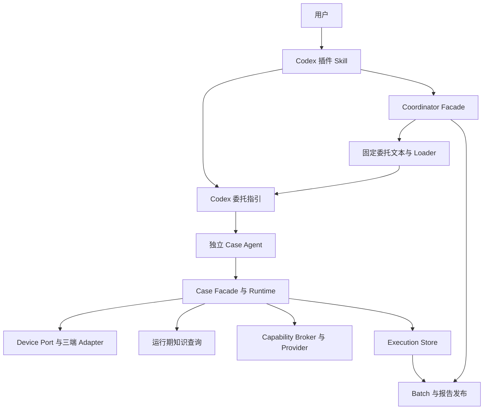

# MAVT 单插件化技术方案

> 实现状态更新：代码和无设备验证已完成，详见 [实现与验证记录](mavt-codex-plugin-implementation.md)。源码归属已按用户要求更新为完整自包含项目；本文其余部分保留调研时的代码事实与评审结论；下述“待实施”和“本次只新增方案文档”描述的是方案编写阶段，不代表当前交付状态。设备验收由用户执行。

> 入口更新：`0.1.1` 将三个发布 Skill 统一为 `author-cases`、`run-tests`、`manage-knowledge`，并增加各自的 `agents/openai.yaml` 中文显示信息；运行时模块名与协议身份保持原有定义。

- 日期：2026-10-21
- 状态：完成第二次源码对照评审，待实施验证；本文定义实现目标，不表示插件已经安装验收。
- 范围：第一阶段支持 Codex，保留后续接入其他 Harness 的边界。
- 调研基线：DevKit `79f8c37d61d3946be451b0f87d43b7e71823c9cb`。
- 关联事实文档：[当前架构](architecture.md)、[设计决策](design-decisions.md)。
- 本次只新增方案文档；不实施插件、不修改工作区数据、不提交 Git。

## 1. 结论

MAVT 以一个名为 `mavt` 的 Codex 插件交付，包含测试执行、用例生成、知识维护三个 Skill。Coordinator、Batch、Case Runtime、Report、Workspace、三端 Adapter 和现有 Capability Provider 仍使用同一套运行时。

采用“单一源码、构建组装、工作区固定运行时”的方案：保留现有源码中的内部目录结构，构建时生成独立可安装的插件；测试 Run 创建前，把运行所需代码和文档复制到工作区内按内容摘要命名的目录，后续命令绑定该副本。插件升级只影响新 Run。

跨 Harness 的扩展边界放在插件清单、Skill 入口和 Agent 委托指引上。核心继续提供宿主无关的 JSON Facade、Handoff 和 Loader。第一阶段不增加 Harness Agent SDK、通用动态插件加载器或全局 Case Runtime MCP。

三平台 Adapter 和 Capability Provider 是插件内部的扩展点，不拆成独立安装包；现有执行状态机、业务判断边界和证据闭环保持不变。

## 2. 目标、约束与非目标

### 2.1 目标

| 编号 | 目标 | 验收依据 |
| --- | --- | --- |
| G1 | 一次安装获得完整 MAVT 能力 | Codex 识别三个 Skill，运行无需访问 DevKit 源码目录 |
| G2 | 保留现有执行与证据模型 | Workspace schema 1、Execution schema 14 及现有回归通过 |
| G3 | 插件目录与测试工作区分离 | 任意工作目录下可调用；安装目录不承载业务写入 |
| G4 | 升级不改变已创建 Run 的实现 | 模拟原安装目录消失后，已绑定 Run 仍能继续、取消和收尾 |
| G5 | 核心可被其他 Harness 复用 | 核心协议、业务 Prompt 和运行时不引用宿主专属工具名 |
| G6 | 有可执行的发布验证 | 安装验收、离线回归、三平台设备冒烟分别留证 |

### 2.2 约束

- 一个 Case Agent 只持有一个 execution 的业务上下文和写入身份；协调 Agent 不读取原始用例、截图或 Case Brief。
- 用例生成、运行期知识调查、知识维护具有不同职责；不得因合包而混用写入入口。
- 新插件不自动安装系统依赖、不在加载时操作设备；依赖准备沿用显式调用的脚本和执行授权。
- Node.js 继续只使用内置模块；本次调研运行环境为 Node.js `v24.18.0`，并未验证更低版本，不据此宣称最低兼容版本。
- 真实资源所有权继续由现有 Platform Runtime 管理，不因代码副本或插件版本改变资源锁的作用域。

### 2.3 非目标

第一阶段不接入其他 Harness，不开放同平台多设备并行，不改变 Execution schema，不迁移历史 execution，不增加独立报告 Skill，不合入 App 路径扫描和人工用例审查，也不重新设计现有 Provider 协议。

[多设备用例执行讨论](device-scoped-case-execution-discussion.md) 是独立议题，不作为本方案已经存在的运行能力。

## 3. 重复调研与验证证据

### 3.1 第一轮：重新核对代码事实

| 事实 | 证据位置 | 对方案的影响 |
| --- | --- | --- |
| Coordinator 已提供 `prepareRun / confirmRun / advanceRun / cancelRun / read` | `scripts/coordinator/agent-facing-contract.js` | 继续复用 Facade，不另建编排协议 |
| Coordinator 正常入口接受预绑定 workspace 或 state，stdin 接收 JSON | `scripts/coordinator-agent.js` | CLI 可作为跨宿主共用入口 |
| Case Agent 的创建由宿主 Agent 完成，代码只提供固定委托文本和 Loader | `scripts/coordinator/agent-facing-service.js`、`scripts/batch/agent-handoff.js` | 宿主适配首先是委托指引，不是 JavaScript `createCaseAgent()` |
| 协调角色的 requiredResources 目前包含根目录 `SKILL.md` | `scripts/lib/agent-contract-manifest.js:17` | 拆 Skill 前必须提取中立协调原则并更新协议摘要 |
| 实现摘要分为 runtime、coordinator、adapter、report | `scripts/build-agent-contract.js`、`scripts/lib/agent-contract-manifest.js:112` | 保留分组摘要；插件版本号不代替运行兼容检查 |
| 生成的 execution 客户端引用当前运行时代码的绝对路径 | `scripts/case-runtime/lifecycle.js:54` | 运行时必须在生成客户端前固定位置 |
| Loader 和协调命令也引用安装树的绝对路径 | `scripts/batch/agent-handoff.js:82`、`scripts/coordinator/agent-facing-service.js` | 只复制 Case Client 不足以支持升级恢复 |
| Case Runtime MCP 需要 `MAVT_EXECUTION_DIR`，批次内还需要 dispatch sequence | `scripts/case-runtime/mcp-server.js:44` | 不能直接注册一个全局共享 MCP 实例 |
| Provider 已有注册契约，默认注册 BCM Provider | `scripts/case-runtime/capability-modules/registry.js:75` | 沿用已有扩展点，不再建立第二套注册系统 |
| 知识维护与运行期知识解析已有兼容测试 | `../mavt-knowledge-manager/scripts/tests/mavt-compatibility.test.js` | 可以合包，但保留两者职责和解析兼容验证 |

当前模块是逻辑分层，并不等同于可以独立发布的库。例如 `scripts/lib/workspace.js` 会调用 Report；`scripts/lib/execution-reader.js` 还依赖 `readers/current-execution.js` 等辅助模块。因此不能把 `scripts/lib` 随意切开，也不能直接把某组摘要清单当作完整发布文件清单。

### 3.2 第二轮：核对 Codex 实物与外部资料

读取并对照了本机已安装的 AIPlaybook、Superpowers、Visualize 插件清单：共同使用 `.codex-plugin/plugin.json`，通过 `skills: "./skills/"` 声明 Skill 目录；AIPlaybook 另外声明 hooks 和 MCP，Visualize 的样本没有这两项。

样本位置：

- `/Users/cm/.codex/plugins/cache/aiplaybook-local/aiplaybook/0.1.34/.codex-plugin/plugin.json`
- `/Users/cm/.codex/plugins/cache/openai-api-curated/superpowers/0722921d/.codex-plugin/plugin.json`
- `/Users/cm/.codex/plugins/cache/openai-bundled/visualize/1.0.50/.codex-plugin/plugin.json`

这些是“当前机器已经安装的插件结构”的证据，不是 MAVT 已通过安装的证据，也不能据此推断任意 Codex 版本都兼容。

本次重复访问 OpenAI 官方文档入口 `https://developers.openai.com/codex/plugins/`、`https://developers.openai.com/codex/skills/` 和 `https://platform.openai.com/docs/codex/plugins`，均返回 HTTP 403，未取得可引用的正文。因此本方案不声称已经通过官方 schema 验证，不给出未经验证的安装命令、环境变量或最低 Codex 版本。实现的首个里程碑必须在实际目标 Codex 中验证候选清单，并记录可工作的安装操作和版本。

随后读取本机 Codex CLI `0.163.0-alpha.10.2` 的 `--help`，确认存在 `plugin marketplace add <SOURCE>`、`plugin add <PLUGIN[@MARKETPLACE]>` 和 `plugin list`。`plugin install` 在该版本明确报不支持。命令参数形式已核实，但本次没有修改用户配置或执行真实安装，也不能把这一 CLI 版本当成已验证的最低版本或桌面 App 版本。

另外读取了 AIPlaybook 的 `/Users/cm/GitProj/aiplaybook/codex-plugins/marketplace/.agents/plugins/marketplace.json`，确认当前项目使用 marketplace 根下的 `.agents/plugins/marketplace.json` 索引，并通过 `source: {source: "local", path: "./plugins/aiplaybook"}` 指向本地插件。发布方案据此补充同类本地 marketplace 结构。

### 3.3 第三轮：全量回归与隔离实验

以下检查均于 2026-10-21 在当前源码上实际执行：

| 检查 | 实际结果 | 证明范围 |
| --- | --- | --- |
| MAVT `node scripts/self-test.js` | 85 组测试通过，退出码 0 | 当前源码回归基线可用 |
| 知识管理 `node scripts/self-test.js` | 6 组测试通过，退出码 0 | 当前维护事务、CLI、文档和解析兼容基线可用 |
| `node scripts/build-agent-facing-docs.js --check` | 51 份生成文档检查通过，退出码 0 | 当前调用契约与参考文档一致 |
| 完整运行时复制到含中文和空格的路径 | 3 平台 × 2 角色 × 5 类摘要全部相同 | 仅改变安装根路径，不改变这些协议及实现摘要 |
| 在复制目录执行六组关键测试 | 全部通过，退出码 0 | Handoff、协调入口、传输和契约可随完整目录搬迁 |
| 比较上述测试前后的复制目录字节摘要 | 无变化 | 这六组测试未改写被测安装树；不代表真实设备路径已经全面验证 |
| 从模拟安装目录创建 Run，随后把安装目录重命名移走 | 原绑定命令出现 `MODULE_NOT_FOUND` | 当前绝对路径绑定确实存在安装缓存失效风险 |
| 从独立运行时副本创建另一个 Run，再移走原安装目录 | 已发布资源 `read` 返回 `SUCCEEDED` | 固定独立代码位置可以避免这一类安装路径失效 |

六组迁移测试为 `boundaries`、`agentHandoff`、`coordinatorAgentFacing`、`entrypoints`、`agentFacingTransportParity`、`agentFacingDocs`。比较的五类摘要为 `protocolSha`、`runtimeSha`、`coordinatorSha`、`adapterSha`、`reportRendererSha`。

实验只在临时目录中复制源码和创建测试工作区，未操作设备。目录移动实验只覆盖 `prepareRun` 和已发布资源读取，没有执行环境确认、完整 Case、取消和设备资源释放；它支持固定副本的设计方向，不代替后续完整升级验收。

临时实验脚本和输出位于 `/tmp/mavt-plugin-feasibility.BsEp28/`；临时目录可能被系统回收，长期结论以本节记录和后续正式测试为准。

## 4. 方案比较与选择

| 方案 | 改动与收益 | 主要问题 | 选择 |
| --- | --- | --- | --- |
| A：只给原 Skill 加插件清单 | 改动最少，能快速探测安装机制 | 职责入口未拆，运行仍依赖可被清理的安装路径 | 用于首轮打包验证，不作为最终交付 |
| B：一个插件、三个 Skill、共享运行时、固定版本副本 | 复用现有状态机，职责清楚，能验证升级边界 | 需要构建清单、路径绑定和少量启动管理代码 | 第一阶段采用 |
| C：拆多个 npm/平台插件，并通过全局 MCP 统一调用 | 可分别发布组件 | 增加版本矩阵，改变执行绑定和委托方式，当前没有需求支撑 | 暂不采用 |

本方案对前期讨论作两处收敛：不进行全量 `core/` 物理重构；不提前实现统一 Agent 生命周期 SDK。跨宿主能力通过共用运行时和少量专属入口实现。

## 5. 单插件与三个 Skill 的边界

| Skill | 职责 | 主要读取内容 | 正式写入入口 |
| --- | --- | --- | --- |
| `run-tests` | 初始化、选择用例、确认环境、委托、继续、取消、汇报 | 中立协调原则、Coordinator 方法索引、Codex 委托指引 | Workspace 和 Coordinator Facade |
| `author-cases` | 阅读材料、判断逻辑用例边界、生成与维护用例 | `references/case-authoring.md` 和当前导入命令文档 | `scripts/import-cases.js` |
| `manage-knowledge` | 知识查看、校验、新增、修改、删除 | 原知识管理 workflow、contract、writing-guide | `knowledge-manager.js` 的 prepare/apply 事务 |

Case Agent 仍是由 Coordinator dispatch 驱动的内部角色，不作为独立用户 Skill 暴露。报告属于执行汇报和已有维护能力，不新增入口。知识查询继续由 Case Runtime 提供，不能转调知识维护 Skill。

三个入口各自按需加载文档，不互相预读完整 Skill。一次“导入后执行”任务可顺序经历 Authoring 和执行协调阶段；进入协调阶段后停止读取业务原文，不把自己的业务理解转述给 Case Agent。原始内容直接由执行快照和 Handoff 交付。

切换 Skill 不会清除当前会话历史。上述顺序保留当前 Skill 允许的阶段切换语义，不宣称 Authoring 与 Coordinator 已被宿主隔离；真正要求独立上下文的是每一个 Case Agent。Case Agent 的入口必须避免重新触发 Authoring 或 Coordinator，不因原 Skill 名称仍出现在 Brief 的契约身份中就重新加载执行协调 Skill。

安装后应只启用一套同用途入口。迁移指导需说明如何停用旧的独立 Skill，防止同时命中旧 Skill 和新插件 Skill；构建及安装过程不自动删除用户已安装的 Skill。

### 5.1 现有能力与规则的迁移对照

三个短入口必须保留触发和职责边界；根 Skill 中的规则要有明确的新归属，不能仅搬脚本：

| 当前能力或约束 | 插件内归属 | 保留要求 |
| --- | --- | --- |
| 任意可读取材料、语义拆分、稳定来源定位、幂等导入 | Authoring Skill、`references/case-authoring.md`、Import | 不按文件/表格行机械拆分，不预生成 Case Flow |
| 环境确认、目标与授权冻结、初始化断点 | 执行 Skill、中立协调原则、Coordinator | 不重复 confirm 或重新创建已存在的 Run |
| 正常状态推进、`UNKNOWN`、原样 command/ref、定向文档 | 中立协调原则、两套 Facade | 不猜参数、不重放未知结果、不跨作用域读取 ref |
| 单写入者、原样 Loader、不继承父上下文 | 中立协调原则、宿主指引、Handoff | Case Agent 独立理解原文；协调角色不读取 Brief 或业务证据 |
| Baseline/Working Flow、视觉登记、结果账本、证据闭环 | 原 Case Prompt、Brief、Case Runtime | 保留 CHECK 适用性、WAIVED/NOT_RUN 条件和 verdict 聚合 |
| `act / runSequence`、目标级输入、知识调查、外部能力 | Case Runtime、三端 Adapter、Provider | 保留瞬态证据、自动动作后采集、冻结目录及 UNKNOWN 不重放 |
| App 初始状态、iOS 包匹配、输入依赖准备 | 中立协调原则、Case Runtime、Adapter | Coordinator 不预判或索取安装包；只执行已授权目标状态能力 |
| 批次技术排障、取消、资源释放、报告发布 | 中立协调原则、Batch、Report | 技术异常不是产品 FAIL，业务终态/资源释放/报告发布分别核验 |
| 知识查看/校验、草稿、prepare/apply、备份 | 知识 Skill、原 workflow/contract/writing-guide | READY 限制、未知省略、删除须明确授权、已授权修改不重复确认、结果列出备份路径 |

验收应分别检查源入口、发布入口和固定文档，不只检查函数是否存在。`mavt-knowledge-manager/SKILL.md` 的硬约束必须进入新入口或其必读原则；现有 workflow 未承载的规则不能因入口缩短而丢失。

## 6. 源码结构与发布结构

### 6.1 源码只维护一份运行时

项目完整收拢到 `mavt/`，完整纳入知识管理；可单独取出本目录开发、测试和构建。项目归属要求以用户的独立项目指令及 [项目边界说明](../../../docs/project-boundary.md) 为准。

```text
mavt/
├── src/
│   ├── mobile-ai-visual-test/       # 完整运行时源码、资源、文档及回归
│   └── mavt-knowledge-manager/      # 完整知识管理源码、模板及回归
├── .codex-plugin/plugin.json
├── skills/                         # 三个 Codex Skill 入口
├── hosts/codex/delegation.md
├── scripts/mavt-entry.js
├── build-plugin.js                 # 只读取项目内部源码
├── release-files.json
├── package.json
├── tests/
├── docs/
└── verification/
```

两套源码从 DevKit `skills/` 完整迁入项目内部，不在构建时读取任何 sibling Skill，不维护重复实现。源码与发布物使用不同顶层目录，避免将未封装的源码误识别为分发 bundle。现有源模块内的直接命令保留用于开发，但升级固定副本的保证只适用于新插件入口创建的 Run。

### 6.2 构建后的完整交付目录

```text
dist/mavt-marketplace/plugins/mavt/
├── .codex-plugin/plugin.json
├── skills/
│   ├── author-cases/                # SKILL.md + agents/openai.yaml
│   ├── run-tests/                   # SKILL.md + agents/openai.yaml
│   └── manage-knowledge/            # SKILL.md + agents/openai.yaml
├── hosts/codex/delegation.md
├── scripts/mavt-entry.js
├── runtime/
│   ├── mobile-ai-visual-test/
│   │   ├── scripts/
│   │   ├── prompts/
│   │   └── references/
│   └── mavt-knowledge-manager/
│       ├── scripts/
│       ├── references/
│       └── assets/
└── bundle.manifest.json
```

`runtime/` 下保留现有脚本相对位置，继续使用 `__dirname` 解析内部依赖。两个运行时目录仍是同级，现有知识兼容测试的相对关系可以保留。发布目录不依赖源码目录、绝对开发路径、符号链接或额外的 `npm install`。

Skill 根目录与运行时根目录从此不同：Skill 通过已加载 `SKILL.md` 的真实文件位置定位插件根目录，再调用插件内的 `scripts/mavt-entry.js`。不依赖尚未验证的 `$CODEX_PLUGIN_ROOT` 等宿主注入变量，不在测试工作区中猜测相对 `scripts/`。

### 6.3 Codex 清单与安装策略

候选清单使用本地样本已经出现的字段，初始版本定为 `0.1.0`：

```json
{
  "name": "mavt",
  "version": "0.1.0",
  "description": "Mobile AI visual testing, case authoring and knowledge maintenance.",
  "skills": "./skills/",
  "interface": {
    "displayName": "MAVT",
    "shortDescription": "移动端 AI 视觉测试"
  }
}
```

这是待实际 Codex 安装器验证的候选配置，不宣称是官方最小 schema。安装元数据若有额外必填项，在首轮安装验证中补齐并固定测试。第一阶段不声明 hooks 或全局 MCP，也不在插件加载时修改用户配置。

第一阶段以本地 marketplace 为安装渠道，整体分发结构为：

```text
dist/mavt-marketplace/
├── .agents/plugins/marketplace.json
└── plugins/mavt/                   # 上节的完整插件
```

索引候选内容为：

```json
{
  "name": "mavt-local",
  "interface": { "displayName": "MAVT Local" },
  "plugins": [
    {
      "name": "mavt",
      "source": { "source": "local", "path": "./plugins/mavt" },
      "policy": { "installation": "AVAILABLE", "authentication": "ON_INSTALL" },
      "category": "Developer Tools"
    }
  ]
}
```

这里沿用实物样本的 marketplace 字段。`authentication` 是索引策略字段，MAVT 不因此增加业务登录或凭证收集；实际安装器是否要求额外行为由 P0 验证并记录。

本机帮助已核实的命令形式可写成以下安装步骤；其中路径须替换为交付产物的绝对目录，本次尚未执行这些写入操作：

```bash
codex plugin marketplace add /absolute/path/to/dist/mavt-marketplace
codex plugin add mavt@mavt-local
codex plugin list --marketplace mavt-local --json
```

归档只用于传输整个 marketplace，解包后才能按此路径注册，不能把 ZIP 直接等同于安装协议。安装操作、桌面会话是否需要重新加载、三个 Skill 的发现与调用语法仍必须在 P0 实测。不得凭清单中的界面说明推断 CLI 与桌面的重载行为相同。

### 6.4 文件清单与构建可重复性

构建工具从固定的源码映射复制文件，保留脚本执行位和资源字节；排除 `.git`、`.DS_Store`、`__MACOSX`、开发 ZIP、临时文件、测试工作区及所有业务证据。

必须包含 Shell 原子脚本、Android IME Java/Manifest 源码、Helper APK 与 `helper_manifest.json`、三端辅助资源、生成的协议文档和知识模板。只复制 `.js` 会遗漏真实依赖。

`bundle.manifest.json` 使用独立 `schemaVersion: 1`，列出 `runtime/` 和 `hosts/` 下每个文件的相对路径、SHA-256 和可执行位。`bundleId` 是这些排序后的记录及格式版本的规范化 SHA-256；不包含时间戳、绝对路径和清单自身，避免摘要自引用。插件版本只用于发布展示，业务兼容仍由原有分组摘要决定。

构建后分别检查：`runtime/`、`hosts/` 的实际文件集合与 bundle 清单完全一致；插件清单、三个 Skill、启动脚本和 marketplace 索引满足独立的发布文件清单。后者不属于固定副本，不能要求它们与仅覆盖 runtime/hosts 的 bundle 清单具有相同文件集合。Node 相对依赖、Shell 动态入口及资源文件都应纳入验证；不能仅靠正则扫描 `require()` 声明依赖闭包已经完整。同一源码构建两次，解包后的文件集合、文件内容、执行位和 `bundleId` 必须一致。

构建与复制时仅接受普通文件、目录及受控相对路径；拒绝符号链接、绝对路径、`..`、重复或规范化后冲突的条目。清单的摘要、路径和执行位都重新核验；不跟随清单外路径。该规则沿用现有 Handoff 对真实目录和路径绑定的严格处理方式，不把摘要相等视为路径归属已经正确。

开发验证包可保留自测文件，正式分发包可移除测试文件；移除后仍需执行独立的发布产物冒烟和资源完整性检查。正式运行使用的源码不得因测试裁剪而变化。

现有自测包含针对原 Skill 布局的断言，例如 MAVT 的 `architecture-boundaries.test.js`、`agent-capability-contract.test.js`、`formal-entrypoints.test.js` 和知识维护的 `skill-docs.test.js` 都直接读取根 `SKILL.md`。新 `runtime/` 布局没有该文件，所以“完整源码搬迁后通过六组测试”不能推导为“最终发布布局可原样执行全部自测”。源布局测试继续验证开发入口；发布物测试应从三个发布入口解析固定文档，并验证第 5.1 节的规则与资源。不得为通过旧断言而在 runtime 中放回会触发重复角色的 Skill 入口，也不得简单删除职责断言。

## 7. 跨 Harness 边界与 Codex 委托



### 7.1 三个明确边界

| 边界 | 负责内容 | 禁止承担的内容 |
| --- | --- | --- |
| Harness 适配 | 插件发现、Skill 入口、创建与等待 Agent、图片及文件访问指引 | 改写用例、替 Runtime 维护执行状态 |
| 确定性核心 | Run/Batch、Handoff、事务、Scene、证据与结果闭环 | 调用 Codex 专属 Agent API、作业务判断 |
| 移动端适配 | 设备事实、观察、动作、平台恢复与资源所有权 | 理解原始用例、生成业务 verdict |

后续支持其他 Harness 时复用 `runtime/` 的实现与协议，新增对应宿主的清单、Skill 包装和委托指引。各宿主分发包可以不同，共享源码继续只有一份。第一阶段不承诺同一个归档可在所有 Harness 直接安装，也不支持活动 Run 跨 Harness 接管。

### 7.2 Codex 指引的实际内容

`hosts/codex/delegation.md` 描述正常顺序：读取 dispatch 的固定委托文本和原样 Loader；使用本次会话实际提供的工具创建不继承协调上下文的 Case Agent；保存真实句柄；等待、响应用户取消，再回到 Coordinator 查询持久化进度。

当前会话提供的工具示例是 `collaboration.spawn_agent` 配合 `fork_turns: "none"`；它只是本会话可用的能力证据，不硬编码为所有 Codex 版本都存在的 API。指引优先识别实际工具清单；不使用不存在的 `close_agent` 等操作，也不指定未经本会话支持的模型。

只有框架请求 `NEED_CASE_AGENT` 且未持有活跃写入 Agent 时才创建。收到 `WAITING` 不重复创建；Agent 返回摘要后仍由 Coordinator 核验并提交。用户取消时先进入原有 `cancelRun` 流程，并在实际宿主支持的范围内停止或中断 Case Agent；宿主中断本身不代表设备资源已经释放。

### 7.3 必需能力与降级边界

| 能力 | 验证方法 | 缺失时行为 |
| --- | --- | --- |
| 本地 Node/Shell 执行 | 启动命令、stdin JSON、进程等待 | 停在环境准备阶段 |
| 新 Agent 的独立上下文 | 以无业务内容的委托探针确认未继承父上下文 | 禁止启动测试；仍可 Authoring/知识维护 |
| 子 Agent 可读取本地图片 | 在新 Agent 中读取本地测试 PNG | 禁止宣称具备视觉测试能力 |
| 子 Agent 可访问固定运行时、工作区及必要设备工具 | 测试目录访问和目标平台探测 | 报告具体不可用能力 |
| 等待与取消反馈 | 观察真实任务句柄、停止后重新核验持久化状态 | 保留状态，不把聊天完成当作执行完成 |

确定性脚本只能探测命令和文件条件，不能证明模型视觉能力或上下文隔离；后两项必须由真实宿主行为验收。不能降级为协调 Agent 亲自执行用例来绕过隔离要求。

用户输入材料的读取工具继续来自宿主，例如表格、PDF、图片工具；MAVT 不打包这些工具，也不把它们变成每次执行的强制依赖。输入格式读取能力应在 Authoring 阶段按需验证。

### 7.4 恢复代码绑定不等于恢复 Agent

当前 `scripts/batch/reconcile-service.js` 对已领取的 `CONSUMED` dispatch 返回 `WAIT_EXECUTION_RESULT`，Coordinator 再投影为 `WAITING`；`advanceRun` 不会自动创建 continuation。底层 `batch.js start --continuation-reason` 可以建立新的 dispatch sequence，但这不是正常 Coordinator Facade 的公开方法。已有 `batch-reconcile.test.js`、`agent-handoff.test.js` 和 `coordinator-agent-facing.test.js` 分别覆盖这些行为。

第一阶段明确保留此边界：

| 恢复时的事实 | 处理 |
| --- | --- |
| 原 Case Agent 句柄仍可取得且活跃 | 重新关联真实句柄并等待，不新建写入者 |
| dispatch 尚未领取，且确认没有活跃 Case Agent | 原样交付已有 Loader，不因恢复创建第二份 dispatch |
| 已领取但无法证明原 Agent 已停止 | 保留 WAITING 和诊断，不因超时或聊天断开自动接管 |
| 宿主已确认原 Agent 停止，execution 尚未终态 | 进入技术恢复，按固定版本的维护文档使用已有 continuation 入口；由框架替换 sequence，再委托全新 Case Agent |
| execution 已终态 | Coordinator 核验、commit、释放和发布，不重执行用例 |

固定版本的维护文档应明确 continuation 的前提、命令和返回 Facade 的方式；协调角色只接触返回的委托元数据，不读取 Brief。此步骤使用当前 Skill 已允许的技术异常维护通道，不增加自动接管 SDK，不在正常 WAITING 时调用维护命令。无法确认旧写入者停止时，允许的结果是明确阻塞或通过原 `cancelRun` 取消，不能承诺自动恢复业务执行。

P0 除安装和 Node 入口外，应先做无设备的独立上下文、图片访问、句柄等待/中断探针。若目标 Codex 无法满足，测试执行部分应在重构前停止；Authoring 与知识维护仍可单独验收。P4 再验证真实设备活动期间的完整生命周期。

## 8. 中立协议、文档路径和摘要调整

新增 `references/coordinator-principles.md`，承接当前 `SKILL.md` 中的协调职责、状态处理、授权边界和恢复原则。执行 Skill 只负责触发条件、路径定位、加载这份原则及宿主委托指引。

`ROLE_RESOURCES['batch-coordinator']` 从 `SKILL.md` 改为这份中立文档；Case Prompt、Case Runtime 方法契约和固定委托文本继续保持中立。`hosts/codex/delegation.md` 不进入核心业务协议摘要，其字节由 bundle 清单单独固定。

调整需要同步 `build-agent-contract.js`、文档生成器及边界测试。现有测试中直接断言 `SKILL.md` 为协调资源的部分应改为校验中立原则，继续保留“核心资源不含宿主工具名”的测试。

运行期间所有相对 `documentationRef` 都必须相对于本次固定运行时解析。Workspace 返回的 Coordinator 绑定和 Case Brief 的 runtime 绑定增加明确的 `documentationRoot`，其值为固定副本中对应运行时的绝对根路径；相对引用内容不必改写。该变更属于 Facade 绑定元数据的有意扩展，需更新契约、文档和精确字段断言，不能默默忽略现有断言失败。

opaque resource ref 仍原样交回同一 Facade 的 `read`。`documentationRoot` 仅用于定位调用文档，不赋予 Agent 拼接资源 ref 或直接编辑执行文件的能力。

期望摘要边界：移动安装根路径不改变现有五类摘要；更改 Codex 委托指引只改变 bundle 身份；更改协调原则改变协调协议摘要；修改某个平台 Adapter 不改变其他平台摘要；修改报告应按原有设计只影响相应报告分组。后者必须由现有边界测试和新增变更测试共同核验。

## 9. 安装位置、运行时固定与升级恢复

### 9.1 管理目录

```text
<workspace>/
├── workspace.json
├── cases/
├── knowledge/
├── app-packages/
├── runs/<batchId>/
│   ├── coordinator-state.json
│   └── runtime-binding.json       # 新增，只管理代码与宿主配置身份
└── .mavt/
    ├── runtime-bundles/<bundleId>/
    │   ├── bundle.manifest.json
    │   ├── runtime/
    │   └── hosts/
    └── knowledge-maintenance/     # 沿用知识维护事务位置
```

`runtime-binding.json` 是独立持久化根，使用 `schemaVersion: 1`，记录类型 `mavtRuntimeBinding`、`batchId`、`bundleId`、`originPluginVersion`、`hostId`、`hostProfileSha`，以及 bundle 内固定的 `runtimeRelativeRoot`。相对根固定为 `runtime/mobile-ai-visual-test`，不能接受任意入口路径。

这份记录不修改 Execution schema 14、用例内容或 verdict；不替代 Batch 冻结的版本与目标绑定。新插件创建的 Coordinator 状态增加 `runtimeBindingRequired: true` 作为必需标识；它不是新的业务状态机。缺少 binding 时，带该标识或命令指向受管理 bundle 的 Run 必须报损坏，不得回退成旧版 Run。只有未带标识且原命令不指向受管理 bundle 的历史记录才作为旧版候选；两种证据冲突则拒绝启动。不能只凭“文件不存在”判断历史版本。

### 9.2 启动顺序

1. Skill 定位插件根目录，通过 `mavt-entry.js workspace --cwd <workspace>` 进入。
2. 验证目标目录。如果是空目录，先调用现有 Workspace 初始化逻辑，使 marker 和基础产物进入 READY；此时不创建 Run、不输出安装目录的 Coordinator 命令。
3. 在 READY 工作区中，把清单限定的 runtime 与 host 文件复制到同一文件系统的临时目录，校验摘要及执行位，再原子重命名为 `runtime-bundles/<bundleId>`。先复制代码再初始化空工作区会破坏“非空目录必须有 marker”的规则，因此顺序不能颠倒。
4. 同一 bundle 已存在时先校验，合格后复用；不完整或摘要不符时拒绝执行，不覆盖现有目录。并发发布使用独立 bundle 锁，失败的临时副本不作为可用版本。
5. 从固定副本调用现有 `workspace.js`，返回指向副本的 Coordinator 命令和文档根。启动管理响应还应明确包含 `bundleId`、`runtimeRoot` 和固定副本中的 `hostProfilePath`，让 Skill 无需猜测文档与工具入口。三类 Skill 随后都使用固定副本内对应脚本，避免依赖安装缓存持续存在。
6. `prepareRun` 分配 batchId 时，先在 `.mavt/run-staging/` 的独占临时目录形成匹配的不可变 binding 和初始 Coordinator 状态，状态中保存最终路径及 `runtimeBindingRequired: true`；同文件系统原子发布整个目录到 `runs/<batchId>` 后，才进入原有环境决策并返回 run command。发布前不得设备操作，目标 Run 已存在则拒绝覆盖。启动或枚举只识别已完整发布的 Run；遗留 staging 只诊断，不凭缺失的业务输入补造状态，也不自动新建替代任务。发布后响应丢失属于 UNKNOWN：先枚举已落盘 Run，不盲目重放 `prepareRun`。后续 `INITIALIZING_RUN` 仍按现有持久化步骤恢复。
7. 环境确认、Batch 初始化、Loader、execution 客户端、报告发布都从同一副本派生。所有框架返回的 command 保持原样使用。

Snapshot 完成前的短暂安装目录依赖仍然存在；如果复制期间原包消失，应返回明确启动错误并重试同一 bundle，不声称升级绝对不会影响尚未完成启动的操作。复制完成之后不再依赖 Codex 缓存保留旧安装树。

知识维护仍以已有 READY 工作区为前提，必须先执行原有工作区校验，不能借公共启动逻辑隐式初始化空目录。`doctor` 也不创建 marker、副本或 Run。只有用户要求初始化或进入允许初始化的用例生成/测试流程时，才执行第 2 步。

`workspace` 是显式选择当前 bundle 的启动动作，不能替代 `resume`。收到继续/取消已有 Run 的请求时，短 Skill 必须先走 `resume` 解析旧绑定，再加载返回位置的协调原则、方法索引和宿主指引，不能先读最新版原则并将其套到旧 Run。

绑定校验不能只放在 `resume`：直接复用已返回命令同样会绕过该入口。插件 Run 的 Coordinator 调用、Loader 领取、Case 客户端调用及具有写入作用的维护入口，都要在本次操作前校验 binding、实际代码根与 bundle 完整性；验证不能重新计算后接受一份身份已改变的 bundle。校验工具保持通用，不在 Case Runtime 中引入 Batch 实现依赖。原开发 Skill 未创建受管理 Run 时保持现有入口语义；受管理 Run 不得从另一 bundle 静默执行。错误发生在职责副作用之前，不写业务事件伪装成产品失败。

### 9.3 继续、取消与清理

新增 `mavt-entry.js resume --workspace <workspace> --run <batchId>`，只读取并校验该 Run 的 runtime binding、固定副本、协调状态和宿主身份，返回已有预绑定命令。它不自行推进 `advanceRun`，也不创建 Case Agent。用户只说“继续”而有多个可选 Run 时，返回结构化候选供选择，不能按最新时间擅自选择设备任务。

继续旧 Run 时加载 runtime binding 对应副本里的宿主指引；核对 `hostProfileSha` 后再采用该文件，不能把最新插件里的委托规则静默套到旧 Run。启动层返回的 `hostProfilePath` 只定位已校验的固定文件，不允许 Run 任意指定宿主指令来源。

新插件版本创建的新 Run 可使用新 bundle；旧 Run 继续使用旧 bundle。副本丢失或校验失败时返回启动层错误 `MAVT_RUNTIME_BUNDLE_MISSING` 或 `MAVT_RUNTIME_BUNDLE_INVALID`，不回退到当前最新代码。只有重新取得摘要完全相同的发布文件并完成校验后才能恢复该版本。

这些错误属于启动管理协议，不映射成产品 FAIL。无法执行旧代码时，当前版本最多提供只读诊断和已有报告位置，不能凭新代码猜测旧 Run 的设备资源归属并自动释放。

第一阶段不提供自动垃圾回收：保留所有已发布的工作区 bundle。后续若增加删除功能，必须确认不存在未终态 Run、活跃 dispatch、待释放资源和待重试的报告发布。包体复制带来磁盘开销，但当前完整源码约为数 MB，并且同一工作区相同 bundle 只保存一份。

外部 Node、Bash、ADB、Appium、Xcode、签名和设备状态不属于代码副本。继续前仍要核验这些条件；固定 MAVT 代码不能保证外部工具升级兼容。复制工作区到另一目录或机器、运行中的跨 Harness 切换也不在第一阶段恢复保证内。

### 9.4 旧版迁移

已有 Workspace 和原始用例仍可创建新插件 Run。已经终态的 execution 和证据不迁移、不补写；已有静态报告不在迁移步骤中重写。正常导入、执行或发布仍可能按原有规则刷新派生报告，不承诺其字节永久不变。尚未结束的旧 Run 应先用原运行时完成或取消，再切换入口；不能因 schema 同为 14 就认为新旧实现和协议摘要相同。

本阶段不改写旧 Coordinator 命令、已有 Loader、绑定快照或 execution 客户端来迁移在途任务。原运行时已不存在的旧 Run 应报告精确缺失条件，不伪装为可继续。

代码固定也不意味着一个 workspace 的首页和平台报告被每个 Run 独占。当前 `execution-reader.js` 对活动 execution 校验当前协议/runtime，对已完成数据使用当前 schema 读取；`report/publication-lock.js` 则按 workspace 真实路径串行发布共享派生产物。两份 bundle 必须沿用同一把锁，验证版本 A/B 及不同平台交错发布后的首页、报告元数据和链接；无法读取的数据维持现有明确降级规则，不以恢复旧 Run 为由覆写其证据或宣称支持任意历史 schema。

## 10. 移动平台、知识与 MCP

### 10.1 三端 Adapter 和外部 Provider

Device Port、三端观察/动作/恢复入口继续保留；固定副本包含三端代码，但每次只探测和准备用户选择的平台。iOS 仍依赖 macOS/Xcode，不能因插件可安装就宣称所有操作系统都能执行三端测试。

Android Helper APK 和清单一起分发并执行现有摘要校验；IME 源码必须保留。现有 Android 构建缓存和所有权记录位于工作区外的缓存目录，设备锁也有自身作用域，不能简单迁移成 bundle 私有锁，否则不同代码版本可能同时操作同一设备。发布验证需确认真实执行不会向插件安装树或固定代码树写临时产物。

Capability Provider 继续使用 `probe / listCapabilities / invoke` 和 execution 冻结目录；Provider 暴露即授权、未知结果不重放等现有规则不变。第一阶段只分发现有 Provider，不因宿主启用了更多 MCP 就自动把全部宿主工具导入 Case Runtime。

### 10.2 知识维护

把现有 `mavt-knowledge-manager` 完整代码和文档随插件组装，保留 prepare/apply、计划摘要、备份和 workspace 校验。Case Runtime 的知识查询保持原接口，知识维护不会直接写 execution 的知识快照。

暂不合并两套知识解析实现；以兼容测试约束一致性，避免打包改造同时改变知识行为。知识条目是在调查时冻结的现有数据，运行时固定不额外冻结整个工作区知识库，也不禁止用户正常维护知识。

现有 `prepare` 只返回计划，`planHash` 绑定知识、草稿和操作内容，不绑定运行时代码版本。第一阶段要求一次维护任务的 prepare/apply 原样使用同一固定副本中的绝对入口；切换插件版本后仍可通过原入口完成该任务。跨会话丢失原入口时不自动接续旧计划，必须在当前选定版本重新 prepare，再使用新计划 apply。这一规则进入 Skill 指引和升级回归，不声称现有 planHash 自带代码版本校验。

### 10.3 MCP 策略

第一阶段的正式传输仍为预绑定 CLI + stdin JSON。保留已有 Case Runtime MCP 源码和传输一致性测试，但不写入插件的全局 `mcpServers` 配置。

原因是该 MCP 在启动时绑定 execution，批次内还要求 dispatch sequence。把它全局挂载会产生作用域错配和多 Agent 可见性问题；允许 Agent 每次传 executionId 又会扩大当前公开参数边界。未来确需 MCP 时单独设计按 dispatch 隔离的服务生命周期，并实测 Harness 的动态绑定能力。

## 11. 需要修改的文件与责任

下表中的新增代码属于后续实现范围，本次未创建：

| 位置 | 改动 |
| --- | --- |
| `.codex-plugin/plugin.json` | 插件清单及实际安装验证后的元数据 |
| `dist/mavt-marketplace/.agents/plugins/marketplace.json` | 构建生成 marketplace 索引；源码模板随构建工具维护 |
| `skills/*/SKILL.md` | 三个职责入口、根路径定位、读取顺序 |
| `hosts/codex/delegation.md` | 实际工具识别、独立委托、等待与取消 |
| 固定版本的维护指引、`references/commands/execution.md` | 明确句柄丢失的证据要求、continuation 和返回 Facade；不将正常 WAITING 改成自动接管 |
| `build-plugin.js` | 固定源码映射、文件集检查、bundle 清单与产物生成 |
| `scripts/mavt-entry.js` | `workspace / resume / doctor` 启动入口；doctor 只读诊断，不自动修复或安装依赖 |
| `src/mobile-ai-visual-test/scripts/lib/runtime-bundle.js` | 清单校验、复制发布、已固定代码位置解析 |
| `src/mobile-ai-visual-test/scripts/lib/runtime-binding.js` | Run 绑定的创建、读取、验证；不能解释用例 |
| `src/mobile-ai-visual-test/references/coordinator-principles.md` | 提取宿主无关的协调协议原则 |
| `scripts/lib/agent-contract-manifest.js`、`scripts/build-agent-contract.js` | 协议资源及新增实现文件的摘要覆盖 |
| `scripts/workspace.js`、`scripts/coordinator/agent-facing-service.js` | 输出固定位置、成对发布 Run binding 与初态、必需标识、文档根；保持正常状态机 |
| `scripts/case-agent-bootstrap.js`、Case 客户端及正式维护入口 | 操作前校验受管理 Run 的 binding 与实际 bundle，直接命令复用不得绕过 |
| `scripts/case-runtime/lifecycle.js`、协议及文档生成相关文件 | Brief 文档根、固定代码的路径验证 |
| 现有边界、入口、文档和知识兼容测试 | 同步有意改变的资源路径和元数据断言 |
| `tests/` | 安装结构、完整分发、搬迁、升级恢复及资源所有权回归 |
| `README.md`、`references/installation.md` | 插件安装、三入口用法、旧 Skill 停用、恢复与版本说明 |

新增模块必须纳入现有摘要清单；构建文件清单和业务分组摘要是两种目的不同的检查，不能互相替代。

## 12. 实施顺序与可独立验收的里程碑

| 阶段 | 交付 | 验收与退出条件 |
| --- | --- | --- |
| P0：验证 Codex 容器 | 最小插件及无设备宿主能力探针 | 实际 Codex 能安装、发现 Skill、执行 Node；确认独立上下文、图片、句柄等待/中断。记录版本和操作；执行必需能力缺失则先停止该部分重构 |
| P1：中立资源与三个入口 | 提取协调原则，三个入口调用同一运行时 | 原 85+6 组回归通过，新增入口互斥与资源引用测试通过 |
| P2：独立发布产物 | 构建清单、完整资源、可搬迁插件目录 | 源码目录不可访问时仍可初始化、导入、读取知识及生成报告；两次构建清单一致 |
| P3：固定版本与恢复 | bundle、副本、Run binding、resume/doctor | 安装目录消失后，未确认、初始化中、Case 执行中、终态待发布各状态可按原规则恢复或明确诊断 |
| P4：真实 Codex 和设备验收 | 委托、视觉读取、三端执行及取消证据 | 满足下一节发布矩阵；升级实验、设备所有权和报告结果均有实际记录 |

P0 可使用当前单 Skill 验证插件加载机制，随后再增加三个正式入口。它是调研性安装探针，不能因为 P0 能加载就跳过 P1–P4 宣布可正式测试。

不把估算工期当作可行性证据。每阶段先验证本阶段最可能失败的边界，再扩展实现。

## 13. 验证矩阵与发布门槛

### 13.1 可自动化验证

| 编号 | 场景 | 必须观察到的结果 |
| --- | --- | --- |
| V1 | 全量源码回归 | MAVT 85 组及知识管理 6 组全部通过，新增测试全部注册 |
| V2 | 完整发布物位于含空格、中文的路径，从任意 cwd 调用 | 初始化、导入、协议构建、知识维护和报告均无需源码树 |
| V3 | 缺失 Shell 原子文件、IME 源码、Helper APK 或文档 | 构建或发布产物校验失败，不能进入设备执行 |
| V4 | 同源码两次构建、仅移动根目录、仅修改宿主指引 | 文件清单可重复；根路径不改核心摘要；宿主修改不改业务协议摘要 |
| V5 | 新建空工作区与中断初始化 | marker 正确进入 READY，固定副本不导致“非空目录无 marker” |
| V6 | 两个进程同时发布同一 bundle、复制中断、文件被改写 | 至多一个完整最终副本；损坏副本不执行；业务事件不被改写 |
| V7 | Run 创建前固定版本，随后移走模拟安装目录 | Coordinator、Loader、客户端和文档仍指向可用副本 |
| V8 | 版本 A 在途、安装 B，再继续 A 和新建 B | A 保持原分组摘要；B 使用新实现；不可静默跨版本接管 |
| V9 | Run binding 或副本缺失、路径越界、摘要不符 | 启动层准确拒绝，无设备动作，无产品 FAIL |
| V10 | 执行中取消、Case Agent 中断、报告发布失败 | 按现有状态机核验取消、释放及报告，不能只看聊天摘要 |
| V11 | 不同版本访问同一设备，或不同平台并行 | 同设备所有权不被代码副本绕过；原有跨平台并行行为保留 |
| V12 | 旧工作区、新 Run 与旧历史 | 新建受支持 Run；历史数据不迁移；在途旧 Run 明确识别 |
| V13 | 最新插件中继续旧 Run 并按错误读取文档 | 使用旧副本的 documentationRoot 和定向错误文档 |
| V14 | 知识 prepare 后版本切换再 apply | 保留原固定入口则沿用；入口丢失则重新 prepare；内容变更仍触发原有计划失效校验 |
| V15 | 新 Run binding 丢失，或状态/绑定发布中断 | 必需标识阻止误判旧 Run；未发布 staging 不作为任务；UNKNOWN 先定位已发布 Run，不重复创建 |
| V16 | 绕过 resume，直接调用原 Coordinator、Loader、客户端或维护命令 | 同样拒绝错 bundle、缺 binding 或损坏副本；拒绝发生在职责副作用之前 |
| V17 | 已领取 dispatch 后丢失句柄 | 无停止证据不接管；停止已证实后按维护流程建立 continuation，旧 sequence 失效；未终态不得 commit 后续用例 |
| V18 | 最终发布布局不含 runtime 根 SKILL.md | 三个发布入口与固定原则正确加载；迁移规则均有断言；不以完整源码迁移实验代替此项 |
| V19 | 不同 bundle、不同平台交错刷新共享报告 | 同一 workspace 发布锁生效，报告元数据和链接一致，不修改历史 execution 或证据 |
| V20 | 新插件继续旧 Run | 先解析旧 binding，再加载旧协调原则和宿主指引；不提前套用最新版原则 |

升级测试至少分别覆盖：`NEED_USER_CONFIRMATION`、持久化初始化中断、`NEED_CASE_AGENT`、已领取 dispatch、execution 已终态但报告待发布。已领取 dispatch 再分别验证“句柄仍在”“已停止”“状态不明”，不将三者统称为可自动恢复。必须在完整构建产物上验证，不能只靠源码内函数单测。

### 13.2 必须在真实宿主和设备执行的验证

| 项目 | 要求 |
| --- | --- |
| Codex 安装 | 从交付产物安装，发现全部入口；停用旧 Skill 后触发无歧义 |
| 独立上下文 | 协调 Agent 的测试标记不应出现在全新 Case Agent 的继承上下文中 |
| 工具继承 | Case Agent 能读固定代码、工作区和图片，执行平台工具，不继承协调业务分析 |
| 单用例与批量 | 一个用例可完成；至少两个用例顺序委托，写入者和业务上下文独立 |
| Android | 观察、中文输入、动作、截图、结果及资源释放；覆盖本次宣称支持的 Helper/降级路径 |
| HarmonyOS | 观察、动作、布局/截图证据、结果及资源释放 |
| iOS | 模拟器完整链路；若继续宣称支持真机，另有真机签名/WDA/Session 冒烟证据 |
| 取消与升级 | 在真实 Case Agent 活跃时取消；在宿主支持的升级/重新安装流程后继续固定版本任务 |

仅跑本地单测不代表真实设备验收通过。第一阶段可以先完成开发验证，但在支持矩阵缺失对应证据前不能宣称该目标已经发布验收。

### 13.3 当前可复跑的源码命令

在 MAVT 源码根目录执行：

```bash
node scripts/self-test.js
node scripts/build-agent-facing-docs.js --check
node scripts/self-test.js boundaries agentHandoff coordinatorAgentFacing entrypoints agentFacingTransportParity agentFacingDocs
```

在知识维护源码根目录执行：

```bash
node scripts/self-test.js
```

后续构建及新启动入口的命令以 P0/P2 实际实现为准；本方案中描述的 `mavt-entry.js` 尚不存在，不应把它当作当前可运行指令。

## 14. 风险、失败处理与最终判定

| 风险 | 设计处理 | 尚需取得的证据 |
| --- | --- | --- |
| 官方文档访问失败、目标 Codex 清单存在差异 | 采用已安装样本的已见字段，P0 在实际目标产品验证 | 清单接受、三个入口发现、实际安装步骤 |
| 子 Agent 工具、隔离或图片能力不足 | 宿主能力门槛，不降级成协调 Agent 执行业务 | 真实隔离和图片探针 |
| 安装缓存升级后旧路径消失 | Run 前固定完整代码及文档，继续使用相同 bundle | 当前仅完成资源读取实验；需完整执行/取消/收尾验收 |
| 复制代码使设备锁被隔离 | 保留现有共享锁和资源所有权位置 | 跨版本同设备竞争测试 |
| 构建遗漏非 JS 资源 | 显式清单、完整性验证、安装树脱离源码测试 | 正式发布产物与三端冒烟 |
| 新旧 Skill 同时触发 | 清晰描述职责，迁移时人工停用旧入口 | 安装后触发测试 |
| 文档与协议摘要不一致 | 契约生成和 `--check`，固定文档根 | 新布局下的生成器和边界回归 |
| 运行时磁盘副本累积 | 同内容去重，首阶段不自动删除 | 后续容量观察；不阻塞正确性 |

当前证据支持方案 B 的代码复用和路径固定方向，可以按 P0 开始实现。真实 Codex 安装、活动 Agent 生命周期及三端设备升级恢复尚未验证，它们是发布门槛，不是已经成立的事实。

## 15. 设计自检记录

| 自检点 | 结论 |
| --- | --- |
| 一个插件是否变成多个独立发布组件 | 否，三个 Skill 与全部运行时随同一产物交付 |
| 是否把“以后支持 Harness”扩成当前通用 SDK 项目 | 否，仅保留清单、入口和委托指引边界 |
| 是否保留现有状态与证据事实来源 | 是，继续由 Facade、Batch、Runtime 和 Store 负责 |
| 是否把逻辑目录当作现成发布依赖闭包 | 否，构建文件清单独立验证并覆盖资源 |
| 是否解决空工作区与代码副本的初始化顺序 | 是，先 READY，再固定副本，再创建 Run |
| 是否把插件升级兼容等同于 schema 相同 | 否，保留 bundle、协议摘要和实现摘要三种身份 |
| 是否把本地 Mock 测试写成真机通过 | 否，分列当前证据和真实设备发布门槛 |
| 是否把实验原型写成已实现能力 | 否，新目录、新入口和新绑定明确属于后续实现 |

## 16. 第二次源码对照评审记录

### 16.1 判定与修订

判定：一个插件、三个 Skill、复用当前 Runtime 的方向与现有框架一致；按本轮修订后可进入 P0 可行性验证。此前方案存在下列缺口，不能直接按“封装即可完整运行”理解。以下是文档修订，不表示对应代码已经实现。

| 编号/等级 | 对照当前实现发现的问题 | 本轮修订 |
| --- | --- | --- |
| R1 / P1 | 固定代码不能恢复宿主 Agent；CONSUMED 后 reconcile 只返回等待，Facade 无自动 continuation | 第 7.4 节按真实句柄状态分流，明确维护 continuation 的前提及无法自动恢复的边界 |
| R2 / P1 | 缺 binding 即判旧版会掩盖新 Run 损坏；分别写两个文件及只在 resume 校验也有漏洞 | 第 9 节增加必需标识、初态与 binding 成对发布、原命令路径的重复校验及 UNKNOWN 处理 |
| R3 / P1 | 缩短入口会遗漏原 Skill 的行为规则；阶段切换也不会清空上下文 | 第 5.1 节逐项迁移能力和约束；明确只有 Case Agent 必须无父上下文 |
| R4 / P2 | 迁移实验复制了完整源码，正式布局却不含 runtime 根 SKILL；既有布局断言不能直接套用 | 第 6.4 节区分源码测试、发布物测试和两种文件清单，不删掉职责语义验证 |
| R5 / P2 | 把真实宿主隔离/视觉能力留到 P4 才验证，可能完成重构后才发现执行前提不成立 | P0 前移无设备能力探针，P4 保留实际设备生命周期验证 |
| R6 / P2 | 固定每个 Run 的代码不代表共享首页/报告归该 Run 独占，静态报告永久不变也不符合现有发布机制 | 第 9.4 节限定不迁移证据，保留共享报告锁与明确降级，新增交错发布验证 |

现有 Framework 的重点行为继续保留：Workspace schema 1、Execution schema 14；Coordinator 五个公开方法；Handoff/dispatch 单写入者；Case Agent 业务判断、Case Flow 和证据闭环；三端 Adapter、Provider 冻结目录；知识事务和报告发布分层。新加的是分发、代码绑定与入口元数据，不能借此另造一套执行状态机。

### 16.2 本轮新取得的证据与限制

2026-10-21 再次实际运行 MAVT 全量自测（85 组）、知识管理全量自测（6 组）和 Agent-facing 文档检查（51 份），均退出码 0；它们证明当前源码基线，尚未验证拟新增的插件、binding 或发布布局。另逐项读取了当前根 Skill、Authoring 文档、知识 Skill、实现摘要清单、Workspace、Coordinator、Handoff、Case 生命周期、dispatch/reconcile、execution reader 和报告锁。

本轮访问 OpenAI 插件文档仍返回 HTTP 403。因此 Codex 的真实安装、Skill 触发、子 Agent 工具与隔离、活动设备取消和升级恢复继续是 P0/P4 的实测门槛；未通过前只可称为经源码评审的设计，不能宣称已经发布可用。
