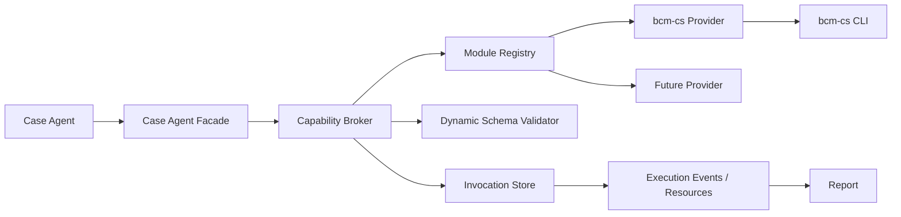
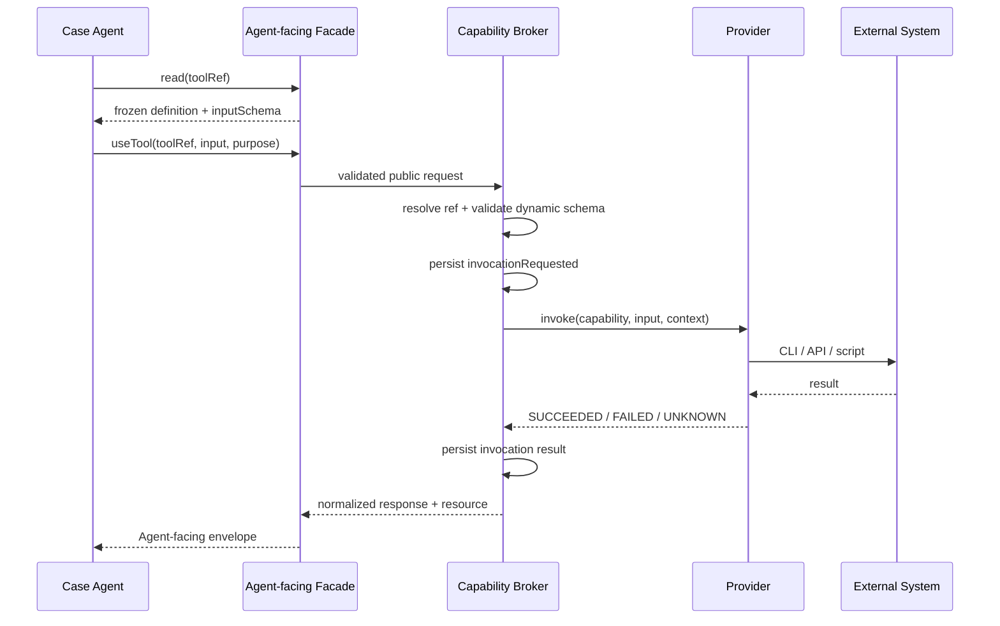

# MAVT 通用能力模块技术方案

日期：2026-10-09

## 1. 背景

MAVT 当前向 Case Agent 提供设备观察、动作、知识调查、恢复和结果记录等固定能力。实际自动化用例还可能需要修改服务端配置、创建测试数据、查询外部系统或调用其他本地工具。首个明确需求是接入本地 `bcm-cs` CLI，使 Case Agent 能在理解用例后自主选择 BCM 能力建立测试所需状态。

不同外部模块的业务功能、输入和实现形式可能完全不同，因此通用层不统一业务字段，只统一模块发现、能力描述、调用、结果和留痕协议。

## 2. 目标

1. Case Agent 能知道当前 execution 有哪些外部工具可用，并按用例语义自主选择。
2. 新模块只需实现统一 Provider 接口并注册，不修改 Case Runtime 的业务状态机。
3. 每项具体工具保留独立名称、说明和 JSON Schema，不被压缩成原始 Shell 字符串。
4. stdin Facade 与 MCP 使用同一权威契约和同一 Broker。
5. 工具调用具备输入校验、超时、确定的结果语义、不可变留痕和报告展示。
6. 首版提供 `bcm-cs` 模块，并消费 CLI 自带的 `capabilities list/describe` 能力。

## 3. 非目标

1. 不提供权限、审批、二次确认或 workspace allowlist；模块和工具一旦暴露给 Case Agent 即视为允许使用。
2. 不为服务器变更保存旧值、自动回滚或执行清理。
3. 不通过 MAVT 锁解决外部系统并发；BCM 同时被其他用户或系统修改是客观环境事实。
4. 不承诺外部状态在一次成功调用后持续不变。
5. 首版不从 workspace 或任意外部目录加载第三方 JavaScript 模块。
6. 不允许 Agent 直接提交任意可执行文件、Shell 命令或未声明参数。

## 4. 已确认原则

### 4.1 暴露即授权

Registry 中成功注册、探测为可用并发布给 Case Agent 的全部工具都可以直接调用。Schema 校验、超时、输出限制和脱敏属于可靠性边界，不是权限控制。

### 4.2 变更持续存在

服务端配置或数据修改后保持现状。后续用例需要不同状态时，由后续 Case Agent 再调用对应工具设置，不依赖前一用例留下的状态，也不要求框架恢复。

### 4.3 并发采用低成本容错

正常路径不增加锁、写后读取、版本比较或自动重试。一次 `SUCCEEDED` 只证明该调用已按模块契约成功返回，不证明外部状态持续有效。只有 App 现场或后续查询出现实际异常时，Case Agent 才按需重新查询、重新设置或结束执行。

若外部干扰持续导致必要前置条件无法建立，应记录为环境因素导致的 `BLOCKED` 或 `INCONCLUSIVE`，不得直接判为产品 `FAIL`。

## 5. 总体架构



职责边界：

- Registry 只管理受信任的内置 Provider。
- Provider 负责发现自己的具体工具，并把工具调用翻译到 CLI、HTTP、数据库或脚本。
- Broker 负责冻结目录、解析 opaque ref、二次 Schema 校验、调用 Provider、映射统一状态和持久化。
- Case Runtime 不理解各工具的业务字段，也不判断工具使用是否符合用例语义。
- Case Agent 仍是 execution 内唯一业务理解者。

## 6. 目录与依赖

新增目录：

```text
scripts/case-runtime/capability-modules/
├── contract.js
├── registry.js
├── broker.js
├── snapshot-store.js
├── invocation-store.js
└── modules/
    └── bcm-cs/
        ├── index.js
        ├── adapter.js
        └── response-mapper.js
```

选择放在 `scripts/case-runtime/` 下有两个原因：

1. 模块只向 Case Agent 暴露，不进入 Coordinator 的业务接口。
2. 现有实现摘要会自动包含 `scripts/case-runtime/`，模块变化自然改变 `runtimeSha` 和 Case Agent 实现绑定。

Provider 不能依赖 Report、Batch 或 Coordinator；Broker 可以使用 Case Runtime 的 execution store、typed resource 和事件能力。

## 7. Provider 接口

Provider 使用 CommonJS 导出以下对象：

```js
module.exports = {
  manifest: {
    id: 'bcm-cs',
    version: '1.0.0',
    summary: 'BCM 测试环境配置与数据能力',
  },

  probe(context) {},
  listCapabilities(context, probeResult) {},
  invoke(request, context) {},
};
```

首版 Provider 方法均为同步方法，与现有 Case Runtime 的同步请求、事务和 CLI 生命周期一致。需要网络访问的 Provider 必须通过受控子进程或其他同步适配器完成；将整个 Runtime 改为异步不属于本方案范围。

### 7.1 `manifest`

必填字段：

| 字段 | 约束 | 含义 |
|---|---|---|
| `id` | `^[a-z][a-z0-9-]*$` | 全局唯一模块 ID |
| `version` | 非空字符串 | Provider 实现版本 |
| `summary` | 非空字符串 | 给 Agent 的模块摘要 |

Registry 在启动时拒绝重复 ID、缺少方法或非法 manifest。首版使用显式注册：

```js
register(require('./modules/bcm-cs'));
```

### 7.2 `probe(context)`

返回模块当前是否可以发现和调用工具：

```js
{
  status: 'READY', // READY | UNAVAILABLE
  implementationVersion: 'bcm-cs 0.1.1',
  diagnostic: null,
  discoverySeed: null,
}
```

`UNAVAILABLE` 是探测事实，不使 execution 初始化失败。该模块不会进入可调用目录，Brief 只保留紧凑诊断，避免 Agent 猜测或直接调用未绑定 CLI。

`discoverySeed` 是仅在当前目录构建过程中传给 `listCapabilities` 的临时值，不直接持久化或投影。Provider 可以用它复用 probe 已完成的远端发现结果，避免正常路径重复请求。

### 7.3 `listCapabilities(context)`

返回该模块的具体工具定义：

```js
[
  {
    name: 'student.update',
    summary: '修改学员信息',
    inputSchema: {
      type: 'object',
      additionalProperties: false,
      properties: {
        studentId: { type: 'string', minLength: 1 },
        fields: { type: 'object' },
      },
      required: ['studentId', 'fields'],
    },
  },
]
```

约束：

- `name` 在模块内唯一，允许用点表达业务层次。
- `inputSchema` 必须是 JSON object schema，并且只使用现有 `agent-json-contract` 验证器支持的 JSON Schema 子集。
- 定义不得携带凭证、环境 Token 或绝对秘密路径。
- Provider 可以静态返回，也可以从外部系统动态发现。
- 所有成功发现的能力都会暴露，不再经过权限过滤。

Agent-facing 全名固定为 `<module-id>.<capability-name>`，例如 `bcm-cs.student.update`；Provider 的 `invoke` 仍接收模块内名称 `student.update`。

### 7.4 `invoke(request, context)`

Broker 传入：

```js
{
  capability: frozenDefinition,
  input: validatedInput,
}
```

Provider 返回：

```js
{
  status: 'SUCCEEDED', // SUCCEEDED | FAILED | UNKNOWN
  summary: '学员信息已更新',
  output: {},
  diagnostic: null,
}
```

Provider 不返回 Agent-facing envelope，也不直接写 execution 事件。统一响应和持久化由 Broker 完成。

## 8. 能力目录与冻结

### 8.1 创建时机

Execution 创建后、Handoff 生成前构建能力目录：

1. Registry 加载内置 Provider。
2. 对每个 Provider 执行 `probe`。
3. 对 `READY` Provider 执行 `listCapabilities(context, probeResult)`。
4. 校验工具定义并生成不可变快照。
5. 将快照摘要写入 execution，并发布 typed resources。

能力发现失败只影响对应模块，不阻断设备测试。若所有外部模块均不可用，MAVT 仍按现有流程运行。

### 8.2 持久化

新增 execution 产物：

```text
capabilities/
├── catalog.snapshot.json
├── definitions/
│   └── <definition-sha>.json
└── invocations/
    └── <operation-id>.json
```

Catalog 保存：

- Provider ID、版本、实现版本和探测事实。
- 工具名称、摘要、definition digest 和 opaque `toolRef`。
- 目录生成时间和整体 digest。

工具定义按内容寻址并保持不可变。调用只接受当前 execution 目录发布的 `toolRef`，不能由模块名和工具名自行拼接，也不能跨 execution 使用。

### 8.3 Brief 投影

Case Brief 新增：

```js
tools: {
  available: [
    { name: 'bcm-cs.student.update', summary: '修改学员信息', toolRef: 'mavt:...' },
  ],
  catalogRef: 'mavt:...',
  unavailableModules: [
    { id: 'bcm-cs', reason: 'capability service returned HTTP 403' },
  ],
}
```

Brief 只内联名称、摘要和 ref。完整 `inputSchema` 通过 `read(toolRef)` 按需读取，继续遵循现有渐进披露原则。

## 9. Agent-facing 契约

### 9.1 新增 `useTool`

Case Runtime 公共能力新增一个稳定入口：

```typescript
useTool({
  toolRef: string;
  input: object;
  purpose: string;
  flowContext?: {
    nodeRef: string;
    selectedEdgeRef?: string;
  };
})
```

公共 Schema 只能约束 `input` 是 object；Broker 使用 `toolRef` 对应的冻结 `inputSchema` 进行第二层严格校验。失败返回字段级 issues，不调用 Provider。

不增加 `listTools` 和 `describeTool`：

- 目录已经随 Brief 提供。
- `read(catalogRef)` 读取完整目录。
- `read(toolRef)` 读取单项定义。
- 避免为同一数据再引入平行读取协议。

### 9.2 stdin 与 MCP

stdin 请求继续使用：

```json
{
  "operation": "useTool",
  "input": {
    "toolRef": "mavt:...:toolDefinition:...",
    "input": {},
    "purpose": "建立用例要求的服务端状态"
  }
}
```

MCP 暴露固定的 `useTool`，其请求经过同一个 `validateAgentFacingRequest`、Translator 和 Broker。首版不把动态能力展开成可变 MCP 顶层方法，原因是：

- 当前 stdin 与 MCP 共享静态权威契约。
- 动态顶层方法会使两个 transport 的工具集合和校验路径分叉。
- Handoff 已能通过工具目录让 Agent 获得具体工具名称与 Schema。

后续若宿主支持 execution 级动态 MCP 注册，可仅增加投影层，把动态方法映射回同一 `useTool`，不改变 Provider 或 Broker。

## 10. 调用流程



`context` 只提供必要执行事实：execution 目录、workspace、平台、目标 App 摘要、operation ID、当前时间和受控进程执行器。它不把 Case 原文、Case Flow 或结果判断交给 Provider。

## 11. 结果和错误语义

### 11.1 成功

`SUCCEEDED` 表示 Provider 按自身契约完成调用并获得成功响应。返回：

- `result.outcome = TOOL_COMPLETED`
- `result.toolName`
- `result.invocationRef`
- 主资源 `toolInvocation`

工具原始复杂输出只保存在 `toolInvocation` 资源中，不重复内联到 `result`。

### 11.2 拒绝

以下情况使用顶层 `REJECTED`，且 Provider 未被调用：

- `toolRef` 未知、跨 execution 或完整性错误。
- 动态输入不符合冻结 Schema。
- execution 已收口。

稳定错误码：

- `TOOL_UNKNOWN`
- `TOOL_SCOPE_MISMATCH`
- `TOOL_INPUT_INVALID`

### 11.3 已知失败

Provider 明确知道调用未成功时使用顶层 `FAILED`：

- CLI 明确返回非零并确认请求失败。
- 服务端返回确定错误响应。
- 输出不符合模块契约且模块能确定没有成功结果。

错误码统一投影为 `TOOL_EXECUTION_FAILED`，模块诊断放入 `technicalFact` 和 invocation 资源。

### 11.4 结果未知

调用已可能送达外部系统，但因超时、连接中断或进程异常无法确定结果时使用顶层 `UNKNOWN`，错误码为 `TOOL_OUTCOME_UNKNOWN`。框架不自动重放；Case Agent 根据用例和可用查询能力决定是否调查或重新设置。

### 11.5 并发与状态漂移

框架不为每次成功调用增加写后查询。若后续 App 现场与预期不符，Case Agent 可以正常再次使用工具查询或设置。只有观察到实际干扰时才产生额外成本。

## 12. 持久化、证据与报告

每次调用至少保存两个追加事件：

- `toolInvocationRequested`
- `toolInvocationCompleted`、`toolInvocationFailed` 或 `toolInvocationOutcomeUnknown`

`toolInvocation` 资源包含：

- 工具定义 digest 和名称。
- 脱敏后的输入。
- 开始、结束和耗时。
- 模块返回状态、摘要和脱敏输出。
- 对应 technical fact 引用（如果有）。

工具调用进入 execution trace 和报告步骤，展示工具名、目的、状态和摘要。成功工具结果默认是外部状态事实，不自动成为 UI CHECK 的通过证据；业务检查仍由 Case Agent 使用 Scene、视觉、知识和允许的技术事实完成。

Artifact Manifest 必须包含已使用的定义快照和 invocation 文件；未使用工具的 definition 仍属于冻结目录的一部分，但不要求单独展示在报告正文。

## 13. `bcm-cs` Provider

### 13.1 探测

依次执行：

1. 从 `BCM_CS_BIN` 或默认命令名 `bcm-cs` 解析可执行文件。
2. `bcm-cs version` 获取实现版本。
3. `bcm-cs --output json capabilities list` 获取能力目录。

当前本机 `bcm-cs 0.1.1` 已安装，但能力目录请求返回 HTTP 403。该情况映射为 `UNAVAILABLE`，不会阻断 MAVT execution，也不会发布不可调用工具。

成功的 list 响应作为 `discoverySeed` 传给 `listCapabilities`，同一次目录构建不会重复执行 list。

### 13.2 能力发现

对 list 返回的每个 capability ID 执行：

```text
bcm-cs --output json capabilities describe <capability_id>
```

Adapter 将 CLI 描述规范化为 Provider capability。无法得到受支持的 object input schema、缺少稳定 ID、缺少可执行调用描述或描述格式无效的单项能力被排除，并写入 catalog diagnostic；其他能力继续可用。

首版在 execution 初始化时完整发现并冻结定义，以确保 `read(toolRef)`、动态校验和实际调用使用同一 Schema。若后续发现能力数量导致明显启动开销，再增加按 CLI 版本与服务地址绑定的共享缓存；首版不提前引入缓存一致性机制。

### 13.3 调用

Adapter 只使用 `child_process.spawnSync` 或 `execFileSync` 参数数组，禁止 `shell: true` 和字符串命令拼接。固定要求 JSON 输出，并设置：

- 发现命令 15 秒进程超时，调用命令 60 秒进程超时。
- stdout/stderr 各 4 MiB 上限。
- UTF-8 解码。
- 对 CLI 退出码、JSON 响应和 HTTP 错误的确定映射。

具体命令参数或 API method/path/body 只来自冻结的 CLI capability 描述和经过 Schema 校验的 Agent 输入。Agent 不传二进制路径、服务地址或任意附加 flags。

### 13.4 脱敏

Broker 提供统一递归脱敏器，至少处理大小写不敏感的以下字段：

```text
authorization, token, access_token, refresh_token, password, cookie, set-cookie, secret
```

Provider 可以追加模块专属字段，但不能关闭统一脱敏。脱敏只影响持久化和 Agent 投影，不改变实际调用参数。

## 14. Execution 格式

新增必需的 capability catalog、事件类型和 artifact manifest 绑定属于 execution 持久化格式变化，因此：

- `EXECUTION_SCHEMA_VERSION` 从 14 升为 15。
- 新 Runtime 只创建和执行 schema 15。
- schema 14 历史 execution 不迁移、不补写、不继续执行，保持现有“重跑生成当前格式”策略。
- Reader、Completion、Result Integrity、Report 和测试同步只接受 schema 15。

Agent-facing public contract 增加 `useTool` 后，`caseProtocolSha` 自然变化；新增 Provider 实现也通过 runtime implementation digest 绑定。

## 15. Prompt 与文档

Case Agent Prompt 增加以下原则：

- 工具目录中的能力均可按用例需要直接使用。
- 工具用于建立或调查执行条件，不替代对 App 现场的业务判断。
- 工具成功结果是调用时刻事实，不承诺外部状态持续不变。
- 不因低概率并发主动重复查询；只有出现实际矛盾时才调查或重新设置。
- `TOOL_OUTCOME_UNKNOWN` 不自动重放。
- 工具明确失败属于技术或环境事实，不直接判产品 FAIL。

`build-agent-facing-docs.js` 从权威契约生成 `useTool` 方法页、资源目录和定向错误恢复文档，不在 Prompt 中复制请求 Schema。

## 16. 测试策略

### 16.1 Provider contract

- manifest、方法和 capability definition 校验。
- 重复模块 ID 和重复工具名拒绝。
- 一个模块不可用不影响其他模块和 execution。

### 16.2 Snapshot 与引用

- 相同定义产生稳定 digest。
- `toolRef` 不可拼接、不可跨 execution、不可篡改。
- Brief 只内联紧凑目录，完整 Schema 通过 `read` 获取。
- continuation 复用原 execution 快照，不重新发现工具。

### 16.3 Broker

- 动态 Schema 校验通过后才调用 Provider。
- `SUCCEEDED / FAILED / UNKNOWN` 正确映射。
- `UNKNOWN` 不触发自动重放。
- finalized execution 只允许 `read`，不允许 `useTool`。
- 输入、输出和错误诊断完成脱敏。

### 16.4 Transport

- stdin 与 MCP 对相同 `useTool` 请求生成相同内部请求和响应。
- MCP 继续直接使用公共权威 Schema。

### 16.5 `bcm-cs`

- 使用 fake executable 覆盖 version、list、describe 和 invoke。
- 覆盖二进制缺失、HTTP 403、无效 JSON、非零退出、超时、超量输出。
- 验证参数数组调用，不经过 Shell。
- 验证发现到的不同业务 Schema 均能发布和调用。
- 真实环境只做显式 smoke test；自动测试不依赖 BCM 服务可用。

### 16.6 格式与报告

- schema 15 全链路一致。
- Artifact Manifest 覆盖目录和已调用产物。
- execution trace 与 HTML 报告展示工具调用。
- 全量 `node scripts/self-test.js` 通过。

## 17. 主要代码改动

| 区域 | 改动 |
|---|---|
| `case-runtime/capability-modules/` | 新增 Provider contract、Registry、Broker、快照与 bcm-cs 模块 |
| `case-runtime/lifecycle.js` | execution 初始化时构建目录；Brief 发布工具摘要和 ref |
| `case-runtime/agent-facing-contract.js` | 新增 `useTool`、资源类型和错误定义 |
| `case-runtime/agent-facing-translator.js` | 解析 tool ref，保留动态输入给 Broker 校验 |
| `case-runtime/runtime-core.js` | 分派 `useTool`，接入时间预算和事件生命周期 |
| `case-runtime/agent-resource-store.js` | 发布 catalog、definition 和 invocation 资源 |
| `case-runtime/mcp-server.js` | 通过公共契约自动暴露固定 `useTool` |
| `lib/agent-contract-manifest.js` | 确认模块进入 runtime implementation digest |
| `lib/execution-artifact-manifest.js` | 纳入 capability 产物 |
| `report/` | 将工具调用投影到 trace 和详情报告 |
| `prompts/`、`references/` | 增加工具使用原则及生成文档 |
| `tests/`、`self-test.js` | 增加模块、Broker、bcm-cs、报告和端到端测试 |

## 18. 实施顺序

1. 先以测试定义 Provider contract、Catalog snapshot 和 opaque ref。
2. 实现 Registry、Snapshot Store 和 execution 初始化集成。
3. 以测试定义 `useTool` 公共契约和动态 Schema 校验。
4. 实现 Broker、事件、资源和错误投影。
5. 实现 fake Provider 端到端路径及 stdin/MCP 一致性。
6. 实现 `bcm-cs` Provider 和 fake executable 测试。
7. 更新 schema 15、Artifact Manifest、Reader 和完整性校验。
8. 更新 Prompt、生成文档、trace 和 HTML 报告。
9. 运行生成文档检查、定向测试和全量 self-test。

## 19. 验收标准

1. Case Brief 能列出当前 execution 实际可用的具体工具。
2. Agent 可读取任意工具的冻结 Schema，并通过 `useTool` 调用。
3. 两个输入形式完全不同的 fake 模块可以同时注册和调用，无需修改 Broker。
4. `bcm-cs` 可用时，其发现能力进入目录；HTTP 403 等不可用状态不阻断设备测试。
5. 所有已发布工具均可直接调用，没有额外授权流程。
6. 服务器变更不自动恢复，并发正常路径没有额外校验或重试。
7. 调用的成功、失败和未知结果完整持久化并出现在报告中。
8. stdin 与 MCP 共享同一契约和执行路径。
9. schema 15、协议摘要、实现摘要和 Artifact Manifest 一致。
10. 全量 `node scripts/self-test.js` 通过。
